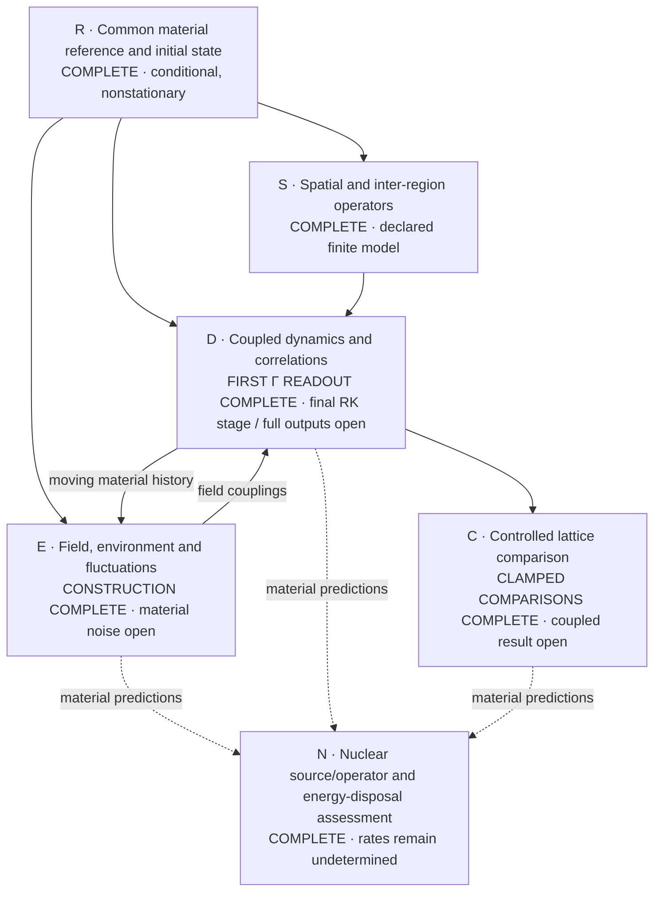
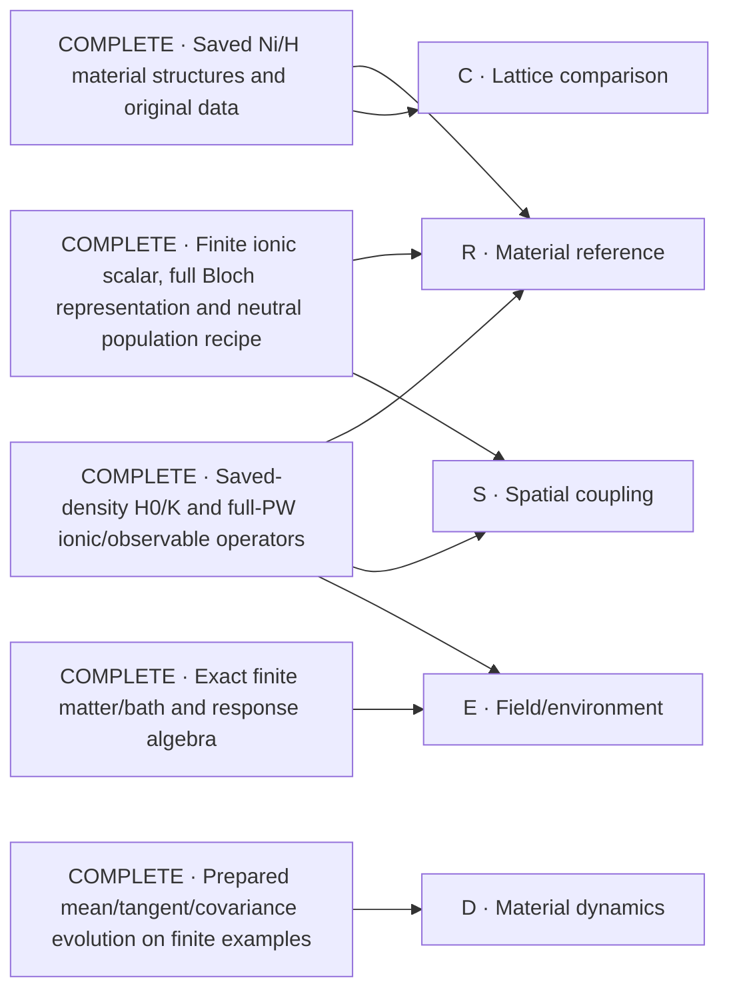

# Ni/H collective-response solution map

The objective is a material-calibrated many-region simulation, a defensible lattice comparison, and an explicit nuclear-transition/energy-disposal construction. This map keeps that whole objective visible. Nodes are scientific outputs, not approval checkpoints. The user's 28 October instruction is to reuse real existing solutions, solve the missing core nodes, and avoid process minutiae. The authoritative scope is [P254](proposal.yaml).

## Core scientific work

Solid arrows identify material inputs needed by a result. Dashed arrows identify future material-prediction inputs, not prerequisites for identifying the nuclear mechanism's missing operator/data. The nuclear source/operator assessment is complete at that exact scope; no other node is marked complete merely because a helper or finite example works.

| Node | Required scientific output | Current work |
| --- | --- | --- |
| R | A declared full-material state with consistent density, force and curvature accounting; reference drift and approximation error remain visible. | **Complete conditional reference and initial state:** all20 sources/all128 slots, weighted density/force/kernel shift, conditional curvature, all raw electronic frames and explicit zero ionic means. The64-cell ionic trap-vacuum and conditional q0 field Gaussian are calculated. Nonzero initial force, declared geometric transport and finite ionic Taylor coefficients remain explicit; this is not equilibrium or physical convergence. Evolving the reference drift belongs to D. [Reference](attempts/0028/full-common-reference-004/summary.json), [electronic state](attempts/0028/full-state-initialization-intake-001.json), [ionic preparation](attempts/0028/ionic-gaussian-material-002/result.json), [field state/scalar](attempts/0028/joint-field-aggregate-001/result.json). |
| S | Material-derived finite-wavevector and inter-region operators, with the actual ionic/electronic spatial coverage. | **Complete operator construction at the declared finite-model scope:** full frozen4×4×4 q-grid/force lattice and conditional-state conversion; physical-UPF same-sector and rectangular finite-q operators use the actual full PW spaces. Independent equations and actual saved/complement probes pass; the scalar handoff includes the fixed curvature correction exactly once. This is not screened phonon response, a convergence claim or permission to reuse future trajectories by symmetry. [Physical material operators and scalar handoff](attempts/0028/physical-spatial-material-001/result.json), [independent oracle](attempts/0028/physical-spatial-oracle-003.json), [common lattice](attempts/0028/full-common-reference-004/summary.json). |
| E | A physical material/field/environment construction with its corresponding fluctuations and energy transfer. | **Constructed and exercised:** whole-material physical-UPF current/contact and mixed coefficients, canonical ionic coupling, conditional q0 field preparation, and Cartesian field-coordinate/momentum observables. The independent moving-response, two-sided covariance and field-readout proofs pass. **Propagated full-material noise remains open; no fitted damping.** Clamped Maxwell-energy exchange is now calculated, but is not irreversible loss or heat. [Joint scalar](attempts/0028/joint-field-aggregate-001/result.json), [moving response proof](attempts/0028/joint-response-oracle-001.json), [completed field-observable proof](attempts/0028/joint-field-readout-oracle-002.json), [actual clamped scientific readouts](attempts/0028/clamped-scientific-summaries-001/result.json). |
| D | Actual material trajectories after local excitation, baseline motion, connected space/time correlations and energy accounting. | **Complete clamped controls:** all four structures, periodic/independent-region couplings and H1/H2 variants use the matched physical scalar, physical C once and zero extra ΔC. **First actual coupled mean complete:** loaded Ni31H6 reaches `0.001` inverse Ry with all128 original electronic sectors and endpoint diagnostics. Its **baseline component-energy ledger is complete**, consuming original saved contributions without another trajectory. The **initial local-pulse energy ledger is also complete** for the four original centered matched preparations, with actual loaded Γ seed metadata checked separately. An independent largest-sector full-PW exponential comparison passes the original target. **Propagated material fluctuations, excitation-energy redistribution and the full spatial response remain open; the short baseline does not resolve a coherence window or certify whole-material accuracy.** [Complete mean](attempts/0028/matched-working-precision-mean-complete-001.json), [baseline energy](attempts/0028/saved-mean-energy-readout-001/summary.json), [initial pulse energy](attempts/0028/local-pulse-energy-readout-001/summary.json), [independent actual-frame comparison](attempts/0028/actual-joint-frame-crosscheck-002/result.json), [actual boundary](attempts/0028/matched-loaded-positive-boundary-001.json), [original/publication identity](attempts/0028/matched-loaded-positive-boundary-publication-001.json). |
| C | Matched lattice comparisons whose conclusions survive relevant numerical, size and physical controls. | **All four initial states and all matched clamped controls are complete.** The common-site comparisons include periodic versus independent-region motion and H2-minus-H1 mass effects for both H-bearing structures. **Equal initial local-pulse dose is now verified for the four original structures** under the declared centered preparation; this is an input control, not a response ranking. Independent regions retain intra-supercell interactions but change field multiplicity/preparation explicitly. **Coupled responses, relevant numerical/size controls and a supported ranking or unresolved comparison remain open.** Full-case geometric coefficient error remains unbounded; no positive-time symmetry or physical convergence is assumed. [Completed control/comparison outputs](attempts/0028/matched-clamped-batch-complete-001.json), [compact scientific comparisons](attempts/0028/clamped-scientific-summaries-001/result.json), [initial matched-dose result](attempts/0028/local-pulse-energy-readout-001/result.json). Complete initial sums/readbacks: [loaded](attempts/0028/matched-loaded-joint-readback-001.json), [pristine](attempts/0028/matched-pristine-joint-readback-001.json), [vacancy](attempts/0028/matched-vacancy-joint-readback-001.json), [dispersed](attempts/0028/matched-dispersed-joint-readback-001.json). |
| N | A sourced transition/operator assessment and medium map with explicit energy/product disposal and exact missing physical inputs. | **Source/operator assessment complete:** DPV1988, BDP1989 and Kim2011 are mapped to their actual operators and physical prerequisites. Evaluated reaction/product energies, ordinary measured channels and conditional NIST transport are consumed. The actual sensitive SymPy witness proves why material coherence alone cannot determine a nuclear rate. Pair preparation, normalized channel/receiver amplitudes, nuclear-frequency matching, exclusive spectra and finite-specimen transport remain missing physical inputs—not invented rates or a universal no-go. [Complete assessment](attempts/0028/nuclear-medium-assessment.md), [executed consumer/oracle](attempts/0028/nuclear-medium-assessment-001.json). |

The integrated result receives one complete scientific review and its necessary corrections, then the required distinct-authorized merge. These are delivery work, not extra scientific nodes.

## What is complete and reusable

These are completed constructions at their recorded scopes. The entries below identify existing solutions only; they do not imply an existing solution for every open node.

| Existing solution | Reuse | Evidence and scope |
| --- | --- | --- |
| Saved full-host material structures and original electronic files | Material geometry, species, masses and source wavefunctions; matched structural controls. | [Primary-material completion](https://github.com/vantasnerdan/substrate-framework/issues/225#issuecomment-6414684011). Declared coarse stationary inputs are complete; numerical calibration and coupled spectra are not thereby complete. |
| Matched saved-density Hamiltonian/kernel and full-PW force/number factors | Existing `qe_material_hamiltonian.py` and material factor/readback APIs, rather than another DFT reconstruction. | [A25 admission](attempts/0025/review-admission.json), with actual-material output and separate readback. This does not select a physical equilibrium state. |
| Full-coordinate material maps and prepared-state evolution | Existing `PreparedReference`, `PreparedFactorDynamics`, prepared covariance and observable consumers. | [A26 admission](attempts/0026/review-admission.json). Actual material maps are complete; finite-time prepared evolution was exercised on a synthetic system, not a completed material trajectory. |
| Finite ionic scalar/common force reference; lazy full Bloch grid; conditional neutral preparation | Existing ionic, `qe_bloch_*`, `material_preparation_*` and authenticated saved-output consumers. | [A27 admission](attempts/0027/review-admission.json). Full electronic representation and population ledger are complete; actual raw preparation/readout covers one selected Gamma sector. Finite ionic sums are not a convergence certificate. |
| Exact matter/field/bath elimination and finite-fermion response identities | Existing `material_matter_field.py` and the admitted finite-fermion constructions. | [A1](attempts/0001/receipt.json) and [A7](attempts/0007/receipt.json), also identified in [the source inventory](proposal.yaml). These supply algebra, not Ni-specific loss parameters or a nuclear mechanism. |
| Evaluated isotope and product-energy data | A source-backed Ni/H reaction ledger with explicit daughter products, decay topology and atomic-reference energy accounting. | [Actual ledger](attempts/0028/nuclear-product-energy-ledger.json), [AME2020/NUBASE2020 provenance](attempts/0028/nuclear-source-acquisition.json), and [source/physical scope](attempts/0028/nuclear-source-registration.json). This calculates available reaction energy, not fusion probability or deposited heat. |
| Actual spatial force lattice and physical finite-q electronic bridge | Complete periodic force-lattice representation and physical-UPF rectangular ionic/density/kernel actions; share physical factors rather than append a second zero-field correction. | [Frozen material grid](attempts/0028/ionic-q-grid-material-001/result.json), [physical material actions/scalar join](attempts/0028/physical-spatial-material-001/result.json), and [conditional-state conversion](attempts/0028/full-common-reference-004/summary.json). Not screened modes or an ASR-repaired matrix. |
| Complete conditional material reference and raw initial state | Reuse all20 source checkpoints, complete128-slot reductions and the already instantiated raw frames/fixed D; no refilling or repeated Gram calculation. | [Full reference](attempts/0028/full-common-reference-004/summary.json), [full initial boundary intake](attempts/0028/full-state-initialization-intake-001.json). Actual force is nonzero; no equilibrium or physical temperature inferred. |
| Saved-primary case inputs, complete matched coefficients and source-exact quantum initial states | Reuse `MatchedJointCase.make_mean`, `make_history` and `bind_response`, plus the original ledgers and authenticated saved-state consumers; do not rebuild DFT backgrounds, refill states or repeat completed contractions. | All four complete sums and actual128-slot readbacks are linked under C. The shared physical-onsite scalar uses zero additional spatial correction. This is reusable input/state construction, not comparative response or convergence. |
| Physical field derivatives and initial quantum force fluctuations | Unanchored physical-UPF current/contact, ordered quasifree kernels and periodic q0 Maxwell normalization; existing stored noise is consumed without new force actions. | [Physical field material](attempts/0028/field-derivatives-material-001/field-derivatives.json), [actual environment consumer](attempts/0028/physical-environment-material-001/summary.json), [independent kernel/field oracle](attempts/0028/physical-environment-oracle-001.json). Original cubic-contact adverse refinement remains retained; finite internal memory is not irreversible loss. |
| Measured ordinary nuclear channels | Primary measured cross sections and conditional capture/second-proton/decay bookkeeping, with source energy domains and upper limits retained. | [Actual table consumer](attempts/0028/measured-nuclear-channels-001.json), [independent oracle](attempts/0028/measured-nuclear-oracle-001.json). The printed Simon Ni58 Q discrepancy is documented against the original page and evaluated masses; no measured table is silently altered. |
| Conditional full ionic quantum preparation | Independent positive clamped-site trap vacua, exact ordered/symmetric covariance and64-cell real/q-space replication; explicit electronic/ionic tensor product. | [Actual material covariance](attempts/0028/ionic-gaussian-material-002/result.json), [independent oscillator/Fock/Fourier and scaling oracle](attempts/0028/ionic-gaussian-oracle-002.json). Sudden-release hypothesis, not measured cooling or equilibrium. Dynamical curvature is unchanged. |
| Original product-transport data and conditional energy ledger | NIST Ni/H photon attenuation and energy absorption, electron stopping in Ni/H, and proton/alpha stopping in H; explicit external paths and supplied spectra. | [Actual original-table consumer](attempts/0028/nuclear-energy-transport-001.json), [independent transfer oracle](attempts/0028/nuclear-transport-oracle-002.json). Ni proton/alpha tables remain unavailable; mixed-material absorption is not fabricated from elemental coefficients; actual heat/power remain unspecified. |
| Complete physical field coefficients and exact frozen-action fusion | Full128-slot current/contact and unanchored-UPF reference corrections; one FFT pair and wide nonlocal products for the unchanged frozen electronic action. | [Field aggregate](attempts/0028/full-field-aggregate-001/result.json), [independent fusion oracle](attempts/0028/fused-action-oracle-001/result.json), [actual full-PW comparison/timing](attempts/0028/fused-action-material-001/result.json). Probe equality and one full-column timing do not establish a propagated material result or whole-run performance. |
| Executed matched ionic–field quantum controls and isotope comparisons | Reuse `material_clamped_array.py` for every ionic coordinate/cell and the field, with the current matched scalar. Independent regions retain intra-supercell coupling and explicitly change field multiplicity/preparation; mass substitution uses sourced NIST H1/H2 inertial masses only. | [All completed material/control/isotope runs and comparisons](attempts/0028/matched-clamped-batch-complete-001.json), [independent dense/SymPy control and isotope proof](attempts/0028/matched-clamped-oracle-001.json). Electrons remain clamped; no fermionic bath, irreversible loss, coherent-state advantage or nuclear prediction follows. |
| Executed physical joint mean and ordered-response equations | Reuse the coupled scalar, complete reduction barriers, independent rectangular ket/bra response and original-preparation two-sided covariance instead of another clamped substitute. | [Mean dynamics/refinement](attempts/0028/joint-streamed-oracle-002.json), [partitioned disk execution](attempts/0028/joint-partitioned-oracle-001.json), [moving response and Fock/two-sided covariance](attempts/0028/joint-response-oracle-001.json), [actual streamed forward/discrete-dual numerical proof](attempts/0028/joint-q-oracle-001.json). The [genuine coupled material baseline](attempts/0028/matched-working-precision-mean-complete-001.json) and [first selected Γ force](attempts/0028/committed-gamma-force-readout-complete-001.json) are complete; material quantum noise and full-grid responses remain open. |
| Bounded full-column mean propagation and recoverable q response storage | Reuse the original-column Arnoldi solver in the unchanged midpoint; retain durable q stages/edge prefixes and retire obsolete payloads only after their successors are durable. | [Column/field-bound proof](attempts/0028/joint-column-mean-oracle-001.json), [complete q numerical/recovery proof](attempts/0028/joint-partitioned-q-storage-oracle-003.json), [actual loaded-history ownership check and forward/pair/all storage plans](attempts/0028/joint-history-memory-check-003/result.json). Whole actual128-sector intake passes under the original4GiB cap after the metadata fix. Split modes are required; actual physical space must account for every donor/cache/target alias before a pair launch. Logical unlinks do not reclaim an inode while another alias survives. A storage forecast is not runtime feasibility, permission to overlap modes or a propagated response. |
| Existing pinned, recoverable QWork workers | Reuse the same disjoint CPU assignments, immutable item receipts and deterministic source-index reduction for a committed-state observable. Each worker returns only one complex scalar; original physical state and saved mean frames remain read-only, without propagation replay. | [Complete actual128-sector Γ force](attempts/0028/committed-gamma-force-readout-complete-001.json), [75 retained terms and53 actual new allocations](attempts/0028/committed-gamma-force-recovery-accounting-001.json), [current independent full-density, complex-factor and generation-aware replay proof](attempts/0028/joint-q-readout-oracle-004.json), [actual Native mapped-page lifecycle and cost check](attempts/0028/committed-readout-mapped-memory-smoke-002.json). Original bytes and open readonly maps survive per-edge page release; cached Native work is not relabelled as current execution. No cap increase or repeated full trajectory is used. This completes the selected observable, not the spatial/two-time response. |
| Complete-grid spatial readout consumer | Reuse coherent √N and ordered-covariance N Fourier normalization, electron/ion/field-origin decomposition, periodic extent and participation. The consumer now accepts the actual native committed-forward receipt directly with its historical request and a separate genuine pair; historical producer and standalone consumer identities are not conflated. | [Current independent dense real-space/SymPy and native/legacy-join proof](attempts/0028/joint-spatial-readout-oracle-002.json), [actual Γ admission with all original source bytes authenticated](attempts/0028/native-spatial-forward-admission-001.json), [exact historical source snapshots](attempts/0028/native-spatial-source-snapshots-001.json), [consumer contract](attempts/0028/joint-spatial-readout-registration.json). No fake legacy/combined result is manufactured. Complete64-q coherent/pair material inputs are still unavailable; no material spatial result is claimed. |
| Physical Cartesian field observables and exact context-only material-noise execution | Reuse `joint_field_probes.py`, the original product-preparation contraction and saved moving mean frames. `SourceLocalTwoSidedCovariance.pair` now reconstructs the unchanged discrete cotangents one source at a time from durable global contexts, keeping independent electron/ion/field origins and distinct probes/times without full-Q scratch or a retained left Q state. | [Existing physical field-response proof](attempts/0028/joint-field-readout-oracle-002.json), [executed exact matrix/Fock/SymPy and field-only consumer proof](attempts/0028/source-local-q-oracle-003.json), [actual128-sector metadata forecast](attempts/0028/source-local-noise-static-plan-001.json). The new executor passes93 finite checks, including its measured replay-action and final-payload accounting. Actual material CLI cutover and full-material noise remain pending; the live D producer's frozen source bytes are unchanged. |
| Executed clamped spatial and Maxwell-energy readouts | Reuse `clamped_scientific_readout.py` for baseline-subtracted local/common displacement, species-resolved participation/extent and physical field mean/covariance energy. Publish compact copies of the actual saved values rather than rerun the calculation. | [All eight paired publications consumed](attempts/0028/clamped-scientific-summaries-001/result.json), [independent real-space/SymPy and mutation proof](attempts/0028/clamped-scientific-readout-oracle-001.json). Periodic finite-cell extent is not an infinite-volume localization length; mean motion is not an entanglement witness. |
| Executed paired physical contractions and actual native forward/adjoint comparison | Reuse shared original-FFT matter transforms and physical Cartesian projector jets in the existing q workers; retain the same scalar, original D and full PW/column spaces. | [Full-column matter proof](attempts/0028/paired-finiteq-full-check-001/result.json), [full-column field proof](attempts/0028/paired-field-full-check-001/result.json), and [actual integrated comparison with retained forward and corrected dual](attempts/0028/paired-contraction-consumer-003/result.json). Selected-edge execution costs are measured; neither whole-grid runtime nor material-response convergence follows. |
| Complete saved coupled mean-energy accounting | Reuse all original initial/final one-body contractions, saved joint stages and matched physical parameters; expose the eleven scalar contributions and their changes rather than repeat electronic actions or infer electronic energy as a residual. | [Compact actual ledger](attempts/0028/saved-mean-energy-readout-001/summary.json), [full source-bound result and exact sensitive Hamiltonian oracle](attempts/0028/saved-mean-energy-readout-001/result.json). Both component totals reproduce the original stored means. This is the unexcited baseline mean, not finite-local-excitation energy, quantum covariance energy or heat; actual summation discrepancies are reported without a fitted term or an invented accuracy bound. |
| Complete initial local-pulse input and matched-dose comparison | Reuse the original four-case masses/charges, common centered preparation and canonical impulse/Fourier convention; `local_pulse_energy.py` computes the initial input without a trajectory or residual energy assignment. | [Compact actual ledger](attempts/0028/local-pulse-energy-readout-001/summary.json), [full original-input consumer and sensitive operator/DFT oracle](attempts/0028/local-pulse-energy-readout-001/result.json). The common Ni1/x impulse gives matched initial input in all four original structures. Actual loaded Γ seed metadata agrees; one Γ share is not the full local input. No propagated energy partition, noise or heat follows. |
| Executed full-material moving-frame preservation and reuse | Reuse the genuine128 full-PW midpoint frames by original-inode hardlinks in a complete cache and an absent, disjoint future namespace; preserve exact physical input/history/count and typed historical worker provenance. Forward/pair may share physical producer identity because mode is not part of that identity. | [All actual original frame records](attempts/0028/actual-loaded-gamma-owner-intake-016.json), [complete original-inode pin proof](attempts/0028/actual-baseline-frame-cache-full-pin-proof-001.json), [actual adoption](attempts/0028/actual-baseline-frame-adoption-001.json), [real QWork admission and independent digest/size/request refusals](attempts/0028/actual-baseline-frame-adoption-check-003-summary.json). All128 frames were admitted through the actual consumer with measured unchanged H0 counters; no payload copies or propagation replay. This is reusable history, not future pair/noise propagation or whole-model completion. |
| Executed coupled coherent mixed-frame and component-energy construction | Reuse full-row fixed-D q/−q product rules, source-local low-rank dyads, canonical physical coordinates, recoverable per-edge RK4 and derivatives of the same eleven energy terms. Exact zeros are full-shape complex128 data descriptors, not enormous zero NPY files; any nonzero, including subnormals, remains a real authenticated payload. No D/Gram inverse, stationary-reference assumption, energy residual fit or Maxwell cell multiplier is introduced. | [Independent nonlinear full-density/SymPy evolution, energy, refinement and real-retired-input replay](attempts/0028/mixed-coupled-response-oracle-003.json), [integrated zero/file lifecycle execution](attempts/0028/exact-zero-integrated-proof-admission-001.json), [physical finite-UPF/Fourier moments](attempts/0028/mixed-material-moments-oracle-002.json), [actual full-material global first stage](attempts/0028/actual-material-exact-zero-stage0-smoke-001.json), and [actual nonzero full-PW Native operator/updates](attempts/0028/actual-material-exact-zero-first-nonzero-native-edge-001.json). This closes the **finite nonstationary construction and real zero-to-nonzero execution path**, not material energy redistribution. The Native pilot stopped at its fixed allocation before a complete mixed timestep or eleven-term material readout. |
| Actual weighted, coefficient-aware moment-only contraction | Reuse the existing `BlochFiniteQBridge.density_from_dyads` for the cancellation-sensitive density; share bounded original-coefficient PW factors and physical projector overlaps for ionic/field moments. No bare-H0 response pass, rank cut or new density implementation. | [Independent nonlinear/dense/SymPy and rectangular-coefficient proof](attempts/0028/mixed-material-moments-shared-factors-oracle-003.json), [actual full-PW source0 comparison](attempts/0028/native-direct-moment-smoke-complete-001.json): all nine plus/minus/mixed density, ionic-gradient and field products are **bitwise identical** to the retained original products. [Original-density diagnosis](attempts/0028/actual-density-original-algorithm-comparison-001.json) established the reusable solution; failed shared-FFT comparisons remain retained. This is a completed contraction component, not a full128-source timestep, whole-run speedup or energy/noise result. |

## Current focus

The critical path remains **propagated material fluctuations, excitation-energy redistribution and matched spatial responses**. The coupled mean, baseline component energies, initial local-pulse input and independent largest-sector comparison are complete. The **first selected Γ Ni1/x force at0.001 inverse Ry is now complete across all128 original sectors**, following all four actual material RHS evaluations and the physical RK4 endpoint. [Fourth RHS](attempts/0028/actual-original-gamma005-fourth-rhs-complete-001.json), [physical checkpoint](attempts/0028/actual-original-gamma005-physical-step-checkpoint-001.json), [full actual complex force](attempts/0028/committed-gamma-force-readout-complete-001.json).

Existing QWork recovery retained75 completed material contractions and calculated only the missing53 under the original owner/deadline. The original timeout/RSS failures and costs remain preserved; the [accounting correction](attempts/0028/committed-gamma-force-recovery-accounting-001.json) separates new work from historical receipts. No propagation was repeated. All128 actual midpoint frames and their preservation/adoption/consumer path are also complete. This short selected response is not a coherence window, numerical-convergence claim or complete spatial reconstruction.

The **finite mixed evolution and eleven-component energy construction passes independent nonlinear full-density/SymPy comparisons, refinement and retired-real-input replay**. The material pilot completed its [first full nonzero global mixed RHS across all128 original sources](attempts/0028/actual-fivecpu-mixed-first-nonzero-global-001.json). Its next nonzero-moment barrier exposed expensive repeated physical contractions. The pilot was [cooperatively stopped with its actual partial receipt and committed work retained](attempts/0028/native-mixed-raw003-cooperative-stop-001.json), rather than extended unchanged. Its internal RK4 evaluation/accumulator are not physical restart endpoints; changed-source continuation is not currently supported. No full mixed timestep or material energy readout is claimed.

**The moment bottleneck repair is implemented and exercised:** the conservative existing-density/shared-projector contraction passes its [independent oracle](attempts/0028/mixed-material-moments-shared-factors-oracle-003.json), and all nine [actual full-column source0 products](attempts/0028/native-direct-moment-smoke-complete-001.json) reproduce the original material arrays bit for bit. The real source0 operator took `347.3746231580153` seconds, excluding the explicitly reported model/input factory; this is not a whole-run performance claim. The simpler existing density path replaces the unsuccessful shared-FFT implementation, without changing the numerical comparison. **Current core D work:** finish the selected original128-source raw-mixed step and eleven complex energy derivatives with this contraction under a measured, bounded allocation; the stopped pilot's costs and internal states remain honestly attributed, not relabeled as a fresh endpoint. These are response-energy coefficients, not finite-dose energy, noise or heat. **Next E:** genuine material two-time noise using the existing pair path and retained inputs. **Next C:** complete64-q coherent/pair inputs, spatial reconstruction with the integrated consumer, relevant controls and a supported lattice comparison or evidenced unresolved comparison. Complete scientific review and distinct-authorized merge follow the whole result; no helper proof or source publication closes E/D/C.

The selected original whole-step allocation [actually stopped at its wall-time limit](attempts/0028/actual-shared-mixed-original-terminal-intake-001.json) on31October at07:11:24 UTC. It retained three complete RK4 stages, the final global preparation and65/128 final-source transitions; its last global physical state is still time0, not a completed timestep or eleven-term energy result. Its original owner, source bytes, start and1712 admitted actions remain retained. [Byte-preserving settled-payload coalescing](attempts/0028/settled-raw003-coalescing-complete-001.json) and [the qualified one-step storage schedule](attempts/0028/next-raw-first-zero-base-storage-forecast-001.json) retain their exact scopes; no later trajectory symmetry or sparse-state replacement was inferred. [Root232's explicit cumulative allocation](attempts/0028/original-source-cumulative-allocation-001.json) now continues the same numerical work under the original clock, not a fresh trajectory or cost reset.

**The repaired D moment bottleneck has now completed on the full material input.** The [actual genuinely nonzero global moment context](attempts/0028/actual-shared-mixed-first-nonzero-moment-global-001.json) includes all128 original source receipts, all128 baseline frames and24 authenticated saved global arrays. After committing that context, the existing solver actually retired all1152 transient moment payloads (`4587319296` bytes); their receipt metadata and the durable context remain retained. The prepared budget was recorded before retirement, so completion is established by the authenticated retirement receipt and actual file absence—not an inferred counter change. The unchanged calculation continues toward the next full mixed-RK4 stage, physical endpoint and eleven energy terms. This is a completed material contraction barrier, not a completed timestep, noise calculation or lattice ranking.

**The third of four RK4 stages is committed across all128 original sectors, and the final stage's global preparation is now complete.** The [exact third-stage completion](attempts/0028/actual-shared-mixed-third-rk-stage-original-001.json) and [intake](attempts/0028/actual-shared-mixed-third-rk-stage-intake-001.json) authenticate its original source transitions and successor headers. On31October at03:17 UTC, the [last-stage global preparation](attempts/0028/actual-shared-mixed-last-rk-moment-global-intake-001.json) completed all128 original moment contributions and24 durable arrays; their raw digests, complex types and finiteness are checked. The existing solver actually retired all1152 transient moment payloads after that publication, retaining their metadata and costs. The [actual final-RK plan](attempts/0028/actual-shared-mixed-final-rk-plan-original-001.json) binds that context. The input evaluation node is at0.001 inverse Ry but is **not the physical endpoint**. That endpoint and the separate eleven-term energy readout remain unfinished.

**Actual final-stage work supersedes callback-count timing scenarios.** The [executed matched-source observation](attempts/0028/final-rk-actual-cost-observation-001.json) authenticates original prior/final records and verifies that proportional action-column counts do **not** justify proportional elapsed time. Older completion scenarios remain historical evidence, not a current ETA, hard bound or diagnosed performance cause. After actual original termination, exclusive owner-lock release and confirmation that the physical endpoint was unfinished, [Root232](attempts/0028/root-allocation-decision-232.json) authorized one additional21600seconds on the **original** start: the cumulative application deadline is31October13:11:23.669518 UTC. All non-time caps,287 numerical sources, owner, action ledger and scientific cache remain unchanged. Numerical sources stay frozen through this continuation; no internal evaluation/accumulator substitutes for a physical endpoint. Uncommitted in-flight RHS work may repeat and remains charged.

**Continuation is implemented, exercised, and now activated—not yet a material recovery result.** The [finite original-RK4/QWork exercise](attempts/0028/cumulative-continuation-oracle-001.json) was actually killed after three completed stages and fresh final-stage preparation; it reused settled work, preserved the original clock/action ledger and reproduced every raw electronic and canonical array bitwise. The [actual original-input restorer](attempts/0028/original-request-readonly-smoke-001.json) matches all287 numerical sources and1358 expanded input bindings against real Native initial provenance without a factory or trajectory replay. The [real user-manager smoke](attempts/0028/continuation-real-user-manager-smoke-001.json) exercised identity, CPU/environment/kernel limits and active-owner exclusion. The [actual continuation service](attempts/0028/original-source-continuation-actual-launch-001.json) started at07:16:22 UTC; [its real owned-process context](attempts/0028/original-source-continuation-actual-context-001.json) verifies the intended identity, groups, environment, kernel file limit and manager caps. These establish activation, **not** completed Native startup, demonstrated material cache reuse, a physical checkpoint or eleven energies.

The [boundary/source-replay consumer](attempts/0028/saved-energy-boundary-oracle-result-003.json) accepts genuine complete RK4 endpoints and rejects internal/partial/changed states. The [actual t0 energy attempt failed](attempts/0028/saved-energy-consumer-source-authority-failure-002.json) because the existing mean reader hardcodes an older proof as current—not because the live driver changed. The [explicit current-proof restorer](attempts/0028/joint_mean_energy_authority.py) [consumes both genuine saved mean stages and their original scalar receipts](attempts/0028/current-saved-mean-authority-smoke-002.json), preserving separate historical physical proof and refusing changed authority. Clean reader migration and a fresh same-input mean ledger wait until the same-source continuation releases the frozen files; they must not invalidate its cache identity between invocations. Then exercise the actual eleven-term saved-boundary CLI, without replaying the trajectory. Source-restoration proof is **not** a completed mixed-energy result.

All287 original producer-bound source files are now [retained with their exact original byte digests](attempts/0028/saved-energy-original-producer-sources-001.json). This is explicitly retrospective source recovery, not a claim that the producer created an execution snapshot. The saved-boundary reader can use that explicit archive after a source cutover while separately binding its current imported implementation; it never imports code from the archive. The [twenty-case proof](attempts/0028/saved-energy-boundary-oracle-result-003.json) exercises actual Native metadata, changed-live-file replay, opaque integer preservation and corrupted/foreign archive refusal. The [real CLI also refuses a wrong archive digest before entering the Native factory](attempts/0028/saved-energy-source-archive-real-cli-refusal-001.json).

**Core E now has an implemented and exercised storage solution.** The [source-local executor](attempts/0028/source-local-q-oracle-003.json) retains complete kernel contexts and canonical stage inputs, replays the original reverse-RK4 graph and applies the existing original-product covariance contraction. The proof covers complex rectangular directed-q legs, singular/nonorthogonal D, unequal admissible weights, distinct nonuniform terminal grids, raw compatibility defects, source-bound restoration and a genuinely propagated field-only quantum seed. Contexts have their own explicit schema; they are not mislabeled mapped-Q checkpoints.

| Noise execution | Prospective successful peak payload (bytes) | Scope |
| --- | ---: | --- |
| Existing full-state pair | 172328405952 | [Original actual-sector forecast](attempts/0028/noise-pair-static-plan-current-001.json). |
| Implemented context-only pair | 41037086784 | [New actual-sector forecast](attempts/0028/source-local-noise-static-plan-001.json), conservatively aliasing only the genuine t0 boundary. |

These are payload forecasts, not measured production peaks; JSON, headers, failed attempts and physical memory/runtime remain separately charged. The new method trades disk for additional original physical actions: the selected one-step/two-time forecast includes7168 bare-Hamiltonian actions, plus any required mean-frame reconstruction. Its finite consumer measured the predicted actions and payload exactly. **Next E action:** connect this executor to the actual material consumer after the current D source freeze releases, measure a representative original full-PW case and run the genuine material pair. No actual propagated material-noise result, fitted damping or heat is claimed.

### Executed clamped-model comparison

These are reported baseline-subtracted **local Ni1/x kick** readouts at the saved time1000 inverse Ry, on the original64-cell grid. Participation is the consumer's effective cell-participation metric, not a count of quantum-coherent cells. RMS distance uses periodic cell centres, not intra-cell atomic separation. Values are displayed to three decimals; no numerical-accuracy certificate or lattice ranking is claimed. Sources: [loaded](attempts/0028/clamped-scientific-summaries-001/loaded-original-paired-atom1.json), [dispersed](attempts/0028/clamped-scientific-summaries-001/dispersed-original-paired-atom1.json), [pristine](attempts/0028/clamped-scientific-summaries-001/pristine-original-paired-atom1.json), [vacancy](attempts/0028/clamped-scientific-summaries-001/vacancy-original-paired-atom1.json); definitions and sensitivity checks are in the [scientific readout proof](attempts/0028/clamped-scientific-readout-oracle-001.json).

| Structure | Coupling | Ni participation | Ni RMS distance (bohr) | H participation |
| --- | --- | ---: | ---: | ---: |
| Loaded Ni31H6 | Periodic | 2.856 | 10.303 | 1.641 |
| Loaded Ni31H6 | Independent regions | 1.000 | 0.000 | 1.000 |
| Dispersed Ni32H6 | Periodic | 4.054 | 12.260 | 6.557 |
| Dispersed Ni32H6 | Independent regions | 1.000 | 0.000 | 1.000 |
| Pristine Ni32 | Periodic | 4.011 | 12.168 | Not applicable |
| Pristine Ni32 | Independent regions | 1.000 | 0.000 | Not applicable |
| Vacancy Ni31 | Periodic | 2.743 | 10.129 | Not applicable |
| Vacancy Ni31 | Independent regions | 1.000 | 0.000 | Not applicable |

The full compact observations also retain the seven time samples, common-kick control, H1/H2 variants, physical Maxwell mean/covariance energy and changes from the same-time baseline. Their original large publications remain byte-bound in local storage. The original batch reader failure is preserved separately; the corrected large-result consumer read all publications successfully without repeating the scientific work. [Publication index](attempts/0028/clamped-scientific-summaries-001/result.json), [reader defect and retained original source](attempts/0028/clamped-scientific-large-result-reader-failure-001.json).

### Initial local-pulse input

These are the verified **initial** inputs for a unit canonical Ni1/x impulse at cell0, using each original parameter archive and the declared centered preparation—not an equilibrium assumption. The Γ column is one Fourier share; all64 shares together give the local input. The independent operator/DFT oracle passes21 checks and exposes11 mutations. Actual loaded Γ seed metadata matches with zero reported discrepancy.

| Original structure | Local input (Ry) | One Γ share (Ry) |
| --- | ---: | ---: |
| Loaded Ni31H6 | 9.346534858e-06 | 1.460396072e-07 |
| Dispersed Ni32H6 | 9.346534858e-06 | 1.460396072e-07 |
| Pristine Ni32 | 9.346534858e-06 | 1.460396072e-07 |
| Vacancy Ni31 | 9.346534858e-06 | 1.460396072e-07 |

This completes initial-input bookkeeping and the equal-dose control, not propagated excitation-energy redistribution, irreversible heat or material-response ranking. Other structures use the common registered centered construction; the saved loaded zero-time means are additionally checked. [Actual source-bound result and oracle](attempts/0028/local-pulse-energy-readout-001/result.json), [compact summary](attempts/0028/local-pulse-energy-readout-001/summary.json).

Source and result details stay in the linked attempts. This document changes when a core result changes, not for every administrative action.

Large raw control archives and the full disk-backed electronic state remain unchanged in local storage with [exact retained-data identities](attempts/0028/retained-local-raw-artifacts-001.json); published code and receipts do not imply those raw arrays are stored in Git.
