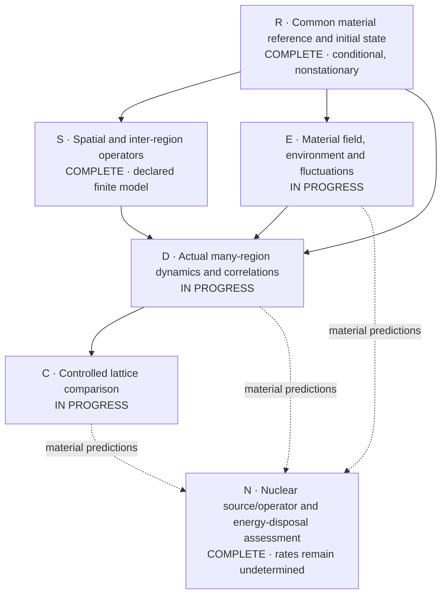
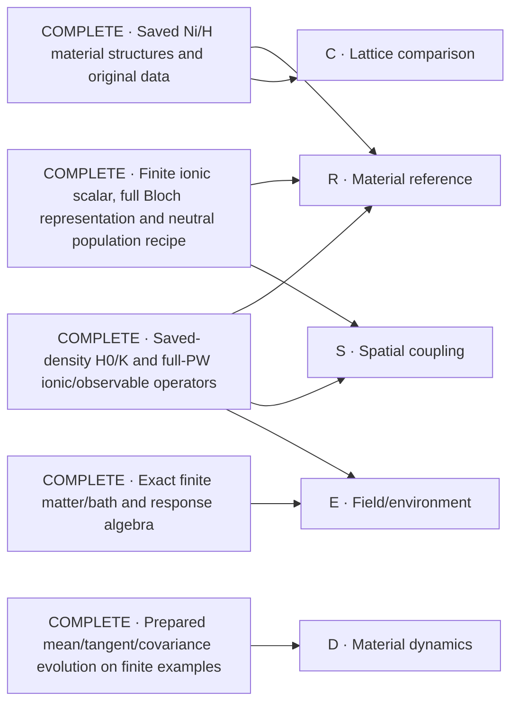

# Ni/H collective-response solution map

The objective is a material-calibrated many-region simulation, a defensible lattice comparison, and an explicit nuclear-transition/energy-disposal construction. This map keeps that whole objective visible. Nodes are scientific outputs, not approval checkpoints. The user's 28 October instruction is to reuse real existing solutions, solve the missing core nodes, and avoid process minutiae. The authoritative scope is [P254](proposal.yaml).

## Core scientific work

Solid arrows identify material inputs needed by a result. Dashed arrows identify future material-prediction inputs, not prerequisites for identifying the nuclear mechanism's missing operator/data. The nuclear source/operator assessment is complete at that exact scope; no other node is marked complete merely because a helper or finite example works.

| Node | Required scientific output | Current work |
| --- | --- | --- |
| R | A declared full-material state with consistent density, force and curvature accounting; reference drift and approximation error remain visible. | **Complete conditional reference and initial state:** all20 sources/all128 slots, weighted density/force/kernel shift, conditional curvature, all raw electronic frames and explicit zero ionic means. The64-cell ionic trap-vacuum and conditional q0 field Gaussian are calculated. Nonzero initial force, declared geometric transport and finite ionic Taylor coefficients remain explicit; this is not equilibrium or physical convergence. Evolving the reference drift belongs to D. [Reference](attempts/0028/full-common-reference-004/summary.json), [electronic state](attempts/0028/full-state-initialization-intake-001.json), [ionic preparation](attempts/0028/ionic-gaussian-material-002/result.json), [field state/scalar](attempts/0028/joint-field-aggregate-001/result.json). |
| S | Material-derived finite-wavevector and inter-region operators, with the actual ionic/electronic spatial coverage. | **Complete operator construction at the declared finite-model scope:** full frozen4×4×4 q-grid/force lattice and conditional-state conversion; physical-UPF same-sector and rectangular finite-q operators use the actual full PW spaces. Independent equations and actual saved/complement probes pass; the scalar handoff includes the fixed curvature correction exactly once. This is not screened phonon response, a convergence claim or permission to reuse future trajectories by symmetry. [Physical material operators and scalar handoff](attempts/0028/physical-spatial-material-001/result.json), [independent oracle](attempts/0028/physical-spatial-oracle-003.json), [common lattice](attempts/0028/full-common-reference-004/summary.json). |
| E | A physical material/field/environment construction with its corresponding fluctuations and energy transfer. | **Calculated:** whole-material physical-UPF current/contact, zero-field corrections and mixed ionic/field coefficients from all20 original sources/all128 slots. These now join in one verified scalar with canonical ionic coupling and an explicitly conditional q0 field Gaussian. Selected ordered force noise and stored-noise/Maxwell normalization are retained. Propagated noise remains open; no fitted damping. [Joint material scalar and field state](attempts/0028/joint-field-aggregate-001/result.json), [noise](attempts/0028/material-force-noise-001/summary.json), [independent scalar oracle](attempts/0028/joint-field-scalar-oracle-001.json). |
| D | Actual material trajectories after local excitation, baseline motion, connected space/time correlations and energy accounting. | **Completed control:** all64 cells/all111 ionic coordinates per cell plus the global q0 field evolved at seven declared times after local and equal-energy common coherent kicks, with baseline motion, spatial/two-time ordered correlations and energy/commutator diagnostics saved. Electrons are held fixed. Separately, a full346-column single-sector frozen electronic exponential is retained; the measured block-basis route is insufficient at its longer times. **Full coupled electronic/ionic/field evolution and propagated fermionic correlations remain open.** [Periodic quantum control](attempts/0028/clamped-array-material-001/result.json), [independent control oracle](attempts/0028/clamped-array-oracle-002/result.json), [retained electronic propagation](attempts/0028/streamed-sector-exponential-001/result.json), [bounded basis result](attempts/0028/block-krylov-material-003/result.json). |
| C | Matched lattice comparisons whose conclusions survive relevant numerical, size and physical controls. | **All four original case H0/K backgrounds and direct coefficient paths execute.** Actual pristine/vacancy/loaded/dispersed pilots retain all original columns; dispersed exercises orbital conjugation, while loaded reuses its exact earlier state and optical/mixed/curvature contractions. The actual saved-output consumer passes. Complete-case coefficients, comparative response/convergence and ranking remain open; initial-coefficient symmetry reuse is being derived rather than assumed. [Pristine pilot](attempts/0028/matched-pristine-pilot-001/slot-0-0-0.json), [vacancy pilot](attempts/0028/matched-empty-pilot-001/slot-0-0-0.json), [loaded reuse](attempts/0028/matched-loaded-pilot-001/slot-0-0-0.json), [dispersed conjugate target](attempts/0028/matched-dispersed-pilot-001/slot-3-0-0.json), [saved-output consumer](attempts/0028/matched-saved-consumer-001/result.json). |
| N | A sourced transition/operator assessment and medium map with explicit energy/product disposal and exact missing physical inputs. | **Source/operator assessment complete:** DPV1988, BDP1989 and Kim2011 are mapped to their actual operators and physical prerequisites. Evaluated reaction/product energies, ordinary measured channels and conditional NIST transport are consumed. The actual sensitive SymPy witness proves why material coherence alone cannot determine a nuclear rate. Pair preparation, normalized channel/receiver amplitudes, nuclear-frequency matching, exclusive spectra and finite-specimen transport remain missing physical inputs—not invented rates or a universal no-go. [Complete assessment](attempts/0028/nuclear-medium-assessment.md), [executed consumer/oracle](attempts/0028/nuclear-medium-assessment-001.json). |

The integrated result receives one complete scientific review and its necessary corrections, then the required distinct-authorized merge. These are delivery work, not extra scientific nodes.

## What is complete and reusable

These are completed constructions at their recorded scopes. The entries below identify existing solutions only; they do not imply an existing solution for every open node.

| Existing solution | Reuse | Evidence and scope |
| --- | --- | --- |
| Saved full-host material structures and original electronic files | Material geometry, species, masses and source wavefunctions; matched structural controls. | [Primary-material completion](https://github.com/vantasnerdan/substrate-framework/issues/225#issuecomment-6414684011). Declared coarse stationary inputs are complete; numerical calibration and coupled spectra are not thereby complete. |
| Matched saved-density Hamiltonian/kernel and full-PW force/number factors | Existing `qe_material_hamiltonian.py` and material factor/readback APIs, rather than another DFT reconstruction. | [A25 admission](attempts/0025/review-admission.json), with actual-material output and separate readback. This does not select a physical equilibrium state. |
| Full-coordinate material maps and prepared-state evolution | Existing `PreparedReference`, `PreparedFactorDynamics`, prepared covariance and observable consumers. | [A26 admission](attempts/0026/review-admission.json). Actual material maps are complete; finite-time prepared evolution was exercised on a synthetic system, not a completed material trajectory. |
| Finite ionic scalar/common force reference; lazy full Bloch grid; conditional neutral preparation | Existing ionic, `qe_bloch_*`, `material_preparation_*` and authenticated saved-output consumers. | [A27 admission](attempts/0027/review-admission.json). Full electronic representation and population ledger are complete; actual raw preparation/readout covers one selected Gamma sector. Finite ionic sums are not a convergence certificate. |
| Exact matter/field/bath elimination and finite-fermion response identities | Existing `material_matter_field.py` and the admitted finite-fermion constructions. | [A1](attempts/0001/receipt.json) and [A7](attempts/0007/receipt.json), also identified in [the source inventory](proposal.yaml). These supply algebra, not Ni-specific loss parameters or a nuclear mechanism. |
| Evaluated isotope and product-energy data | A source-backed Ni/H reaction ledger with explicit daughter products, decay topology and atomic-reference energy accounting. | [Actual ledger](attempts/0028/nuclear-product-energy-ledger.json), [AME2020/NUBASE2020 provenance](attempts/0028/nuclear-source-acquisition.json), and [source/physical scope](attempts/0028/nuclear-source-registration.json). This calculates available reaction energy, not fusion probability or deposited heat. |
| Actual spatial force lattice and physical finite-q electronic bridge | Complete periodic force-lattice representation and physical-UPF rectangular ionic/density/kernel actions; share physical factors rather than append a second zero-field correction. | [Frozen material grid](attempts/0028/ionic-q-grid-material-001/result.json), [physical material actions/scalar join](attempts/0028/physical-spatial-material-001/result.json), and [conditional-state conversion](attempts/0028/full-common-reference-004/summary.json). Not screened modes or an ASR-repaired matrix. |
| Complete conditional material reference and raw initial state | Reuse all20 source checkpoints, complete128-slot reductions and the already instantiated raw frames/fixed D; no refilling or repeated Gram calculation. | [Full reference](attempts/0028/full-common-reference-004/summary.json), [full initial boundary intake](attempts/0028/full-state-initialization-intake-001.json). Actual force is nonzero; no equilibrium or physical temperature inferred. |
| Saved-primary control intake and real-collinear conjugation | The same generic case intake, full-grid population policy and explicit within-spin orbital-conjugation construction. | Actual [pristine](attempts/0028/control-pristine-ni32-001/result.json), [vacancy](attempts/0028/control-empty-vacancy-ni31-001/result.json), [loaded](attempts/0028/control-loaded-ni31h6-001/result.json), [dispersed](attempts/0028/control-dispersed-ni32h6-001/result.json). Input/preparation coverage, not comparative stability. |
| Physical field derivatives and initial quantum force fluctuations | Unanchored physical-UPF current/contact, ordered quasifree kernels and periodic q0 Maxwell normalization; existing stored noise is consumed without new force actions. | [Physical field material](attempts/0028/field-derivatives-material-001/field-derivatives.json), [actual environment consumer](attempts/0028/physical-environment-material-001/summary.json), [independent kernel/field oracle](attempts/0028/physical-environment-oracle-001.json). Original cubic-contact adverse refinement remains retained; finite internal memory is not irreversible loss. |
| Measured ordinary nuclear channels | Primary measured cross sections and conditional capture/second-proton/decay bookkeeping, with source energy domains and upper limits retained. | [Actual table consumer](attempts/0028/measured-nuclear-channels-001.json), [independent oracle](attempts/0028/measured-nuclear-oracle-001.json). The printed Simon Ni58 Q discrepancy is documented against the original page and evaluated masses; no measured table is silently altered. |
| Conditional full ionic quantum preparation | Independent positive clamped-site trap vacua, exact ordered/symmetric covariance and64-cell real/q-space replication; explicit electronic/ionic tensor product. | [Actual material covariance](attempts/0028/ionic-gaussian-material-002/result.json), [independent oscillator/Fock/Fourier and scaling oracle](attempts/0028/ionic-gaussian-oracle-002.json). Sudden-release hypothesis, not measured cooling or equilibrium. Dynamical curvature is unchanged. |
| Original product-transport data and conditional energy ledger | NIST Ni/H photon attenuation and energy absorption, electron stopping in Ni/H, and proton/alpha stopping in H; explicit external paths and supplied spectra. | [Actual original-table consumer](attempts/0028/nuclear-energy-transport-001.json), [independent transfer oracle](attempts/0028/nuclear-transport-oracle-002.json). Ni proton/alpha tables remain unavailable; mixed-material absorption is not fabricated from elemental coefficients; actual heat/power remain unspecified. |
| Complete physical field coefficients and exact frozen-action fusion | Full128-slot current/contact and unanchored-UPF reference corrections; one FFT pair and wide nonlocal products for the unchanged frozen electronic action. | [Field aggregate](attempts/0028/full-field-aggregate-001/result.json), [independent fusion oracle](attempts/0028/fused-action-oracle-001/result.json), [actual full-PW comparison/timing](attempts/0028/fused-action-material-001/result.json). Probe equality and one full-column timing do not establish a propagated material result or whole-run performance. |
| Executed periodic ionic–field quantum control | Existing `material_clamped_array.py` evolves every ionic coordinate/cell and the one global field; reuse baseline, local/common kicks and ordered correlation readouts. | [Complete actual control](attempts/0028/clamped-array-material-001/result.json), [independent dense real-space and normalization oracle](attempts/0028/clamped-array-oracle-002/result.json). Electrons remain clamped; no fermionic bath, irreversible loss, coherent-state advantage or nuclear prediction follows. |

## Current focus

The critical path is **coupled material evolution and matched responses**. R and S are complete constructions of the declared conditional finite model; E/D/C remain open. The full periodic ionic–field control now runs, but does not replace electronic dynamics. Original-channel angular matrices and an actual aligned physical-operator covariance assessment are available; they do not authorize arbitrary moving-stage or antiunitary trajectory reuse. Work now connects the existing moving-mean finite-q response, tests independent-column propagation instead of a larger unchanged block basis, and constructs measured initial-coefficient reuse for the four-case comparison. [Physical covariance](attempts/0028/operator-covariance-physical-aligned-001/result.json), [current allocation](attempts/0028/root-allocation-decision-018.json). New computation uses only CPUs6–10; completed results and old Native/cloud dispositions are preserved.

Source and result details stay in the linked attempts. This document changes when a core result changes, not for every administrative action.

Large raw control archives and the full disk-backed electronic state remain unchanged in local storage with [exact retained-data identities](attempts/0028/retained-local-raw-artifacts-001.json); published code and receipts do not imply those raw arrays are stored in Git.
