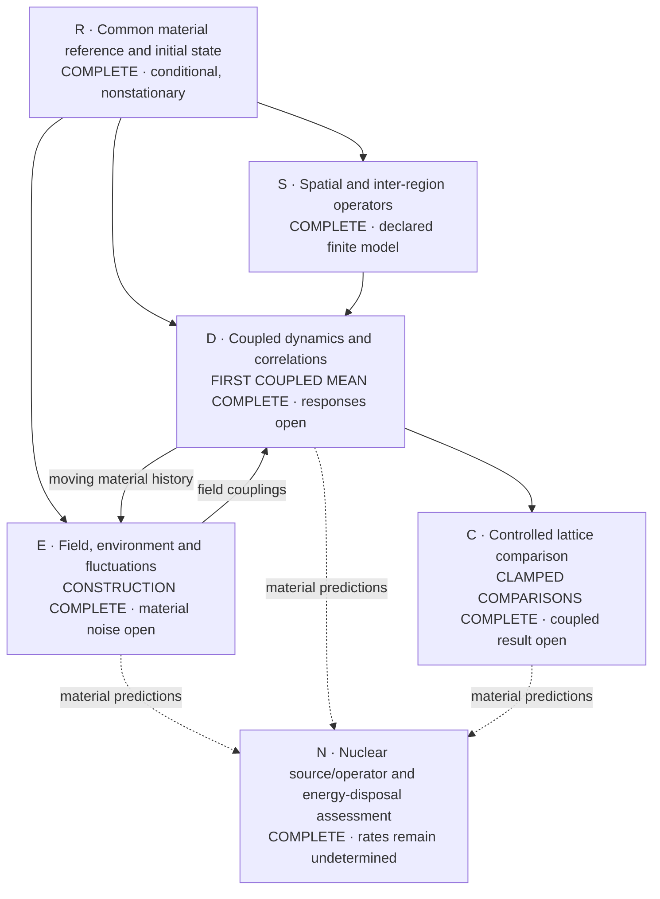
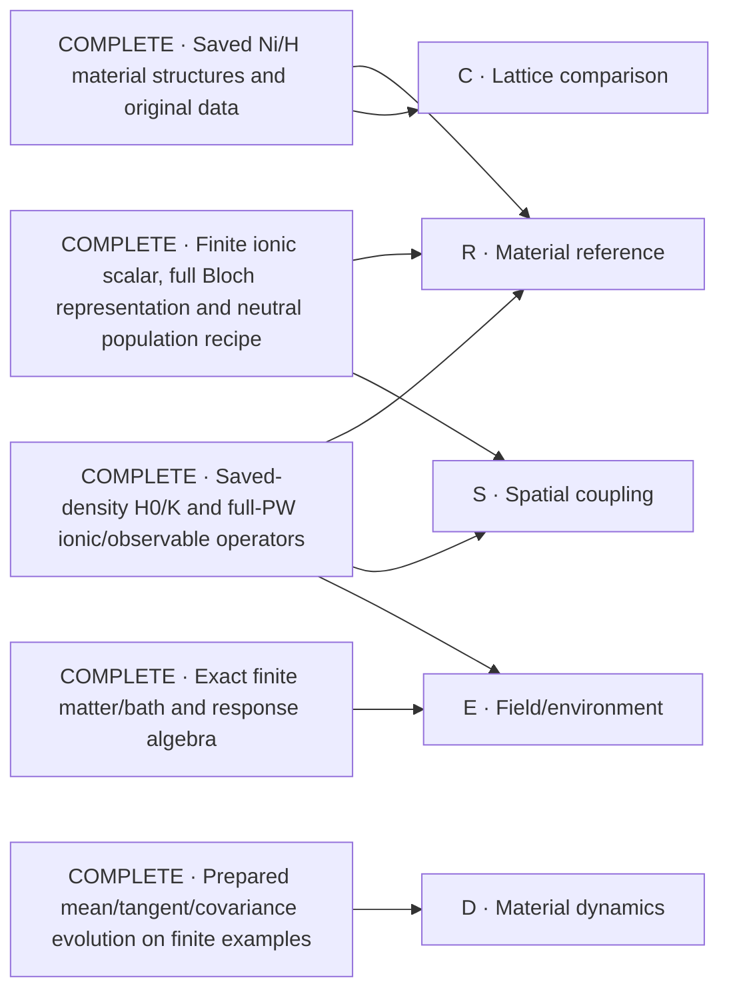

# Ni/H collective-response solution map

The objective is a material-calibrated many-region simulation, a defensible lattice comparison, and an explicit nuclear-transition/energy-disposal construction. This map keeps that whole objective visible. Nodes are scientific outputs, not approval checkpoints. The user's 28 October instruction is to reuse real existing solutions, solve the missing core nodes, and avoid process minutiae. The authoritative scope is [P254](proposal.yaml).

## Core scientific work

Solid arrows identify material inputs needed by a result. Dashed arrows identify future material-prediction inputs, not prerequisites for identifying the nuclear mechanism's missing operator/data. The nuclear source/operator assessment is complete at that exact scope; no other node is marked complete merely because a helper or finite example works.

| Node | Required scientific output | Current work |
| --- | --- | --- |
| R | A declared full-material state with consistent density, force and curvature accounting; reference drift and approximation error remain visible. | **Complete conditional reference and initial state:** all20 sources/all128 slots, weighted density/force/kernel shift, conditional curvature, all raw electronic frames and explicit zero ionic means. The64-cell ionic trap-vacuum and conditional q0 field Gaussian are calculated. Nonzero initial force, declared geometric transport and finite ionic Taylor coefficients remain explicit; this is not equilibrium or physical convergence. Evolving the reference drift belongs to D. [Reference](attempts/0028/full-common-reference-004/summary.json), [electronic state](attempts/0028/full-state-initialization-intake-001.json), [ionic preparation](attempts/0028/ionic-gaussian-material-002/result.json), [field state/scalar](attempts/0028/joint-field-aggregate-001/result.json). |
| S | Material-derived finite-wavevector and inter-region operators, with the actual ionic/electronic spatial coverage. | **Complete operator construction at the declared finite-model scope:** full frozen4×4×4 q-grid/force lattice and conditional-state conversion; physical-UPF same-sector and rectangular finite-q operators use the actual full PW spaces. Independent equations and actual saved/complement probes pass; the scalar handoff includes the fixed curvature correction exactly once. This is not screened phonon response, a convergence claim or permission to reuse future trajectories by symmetry. [Physical material operators and scalar handoff](attempts/0028/physical-spatial-material-001/result.json), [independent oracle](attempts/0028/physical-spatial-oracle-003.json), [common lattice](attempts/0028/full-common-reference-004/summary.json). |
| E | A physical material/field/environment construction with its corresponding fluctuations and energy transfer. | **Constructed and exercised:** whole-material physical-UPF current/contact and mixed coefficients, canonical ionic coupling, conditional q0 field preparation, and Cartesian field-coordinate/momentum observables. The independent moving-response, two-sided covariance and field-readout proofs pass. **Propagated full-material noise remains open; no fitted damping.** Clamped Maxwell-energy exchange is now calculated, but is not irreversible loss or heat. [Joint scalar](attempts/0028/joint-field-aggregate-001/result.json), [moving response proof](attempts/0028/joint-response-oracle-001.json), [completed field-observable proof](attempts/0028/joint-field-readout-oracle-002.json), [actual clamped scientific readouts](attempts/0028/clamped-scientific-summaries-001/result.json). |
| D | Actual material trajectories after local excitation, baseline motion, connected space/time correlations and energy accounting. | **Complete clamped controls:** all four structures, periodic/independent-region couplings and H1/H2 variants use the matched physical scalar, physical C once and zero extra ΔC. **First actual coupled mean complete:** loaded Ni31H6 reaches `0.001` inverse Ry with all128 original electronic sectors and all endpoint diagnostics. An independent full-PW exponential calculation of the largest sector passes the original column-comparison target and rejects the unchanged initial frame. **Propagated material fluctuations and the full spatial response remain open; this short trajectory and one-sector check do not resolve a coherence window or certify whole-material accuracy.** [Complete mean and diagnostics](attempts/0028/matched-working-precision-mean-complete-001.json), [independent actual-frame comparison](attempts/0028/actual-joint-frame-crosscheck-002/result.json), [actual boundary](attempts/0028/matched-loaded-positive-boundary-001.json), [original/publication identity](attempts/0028/matched-loaded-positive-boundary-publication-001.json). |
| C | Matched lattice comparisons whose conclusions survive relevant numerical, size and physical controls. | **All four initial states and all matched clamped controls are complete.** The common-site comparisons include periodic versus independent-region motion and H2-minus-H1 mass effects for both H-bearing structures. The independent-region construction retains intra-supercell interactions but changes field multiplicity/preparation explicitly. **Coupled responses, relevant numerical/size controls and a supported ranking or unresolved comparison remain open.** Full-case geometric coefficient error remains unbounded; no positive-time symmetry or physical convergence is assumed. [Completed control/comparison outputs](attempts/0028/matched-clamped-batch-complete-001.json), [compact scientific comparisons](attempts/0028/clamped-scientific-summaries-001/result.json). Complete initial sums/readbacks: [loaded](attempts/0028/matched-loaded-joint-readback-001.json), [pristine](attempts/0028/matched-pristine-joint-readback-001.json), [vacancy](attempts/0028/matched-vacancy-joint-readback-001.json), [dispersed](attempts/0028/matched-dispersed-joint-readback-001.json). |
| N | A sourced transition/operator assessment and medium map with explicit energy/product disposal and exact missing physical inputs. | **Source/operator assessment complete:** DPV1988, BDP1989 and Kim2011 are mapped to their actual operators and physical prerequisites. Evaluated reaction/product energies, ordinary measured channels and conditional NIST transport are consumed. The actual sensitive SymPy witness proves why material coherence alone cannot determine a nuclear rate. Pair preparation, normalized channel/receiver amplitudes, nuclear-frequency matching, exclusive spectra and finite-specimen transport remain missing physical inputs—not invented rates or a universal no-go. [Complete assessment](attempts/0028/nuclear-medium-assessment.md), [executed consumer/oracle](attempts/0028/nuclear-medium-assessment-001.json). |

The integrated result receives one complete scientific review and its necessary corrections, then the required distinct-authorized merge. These are delivery work, not extra scientific nodes.

## What is complete and reusable

These are completed constructions at their recorded scopes. The entries below identify existing solutions only; they do not imply an existing solution for every open node.

| Existing solution | Reuse | Evidence and scope |
| --- | --- | --- |
| Saved full-host material structures and original electronic files | Material geometry, species, masses and source wavefunctions; matched structural controls. | [Primary-material completion](https://github.com/vantasnerdan/substrate-framework/issues/225#issuecomment-6414684011). Declared coarse stationary inputs are complete; numerical calibration and coupled spectra are not thereby complete. |
| Matched saved-density Hamiltonian/kernel and full-PW force/number factors | Existing `qe_material_hamiltonian.py` and material factor/readback APIs, rather than another DFT reconstruction. | [A25 admission](attempts/0025/review-admission.json), with actual-material output and separate readback. This does not select a physical equilibrium state. |
| Full-coordinate material maps and prepared-state evolution | Existing `PreparedReference`, `PreparedFactorDynamics`, prepared covariance and observable consumers. | [A26 admission](attempts/0026/review-admission.json). Actual material maps are complete; finite-time prepared evolution was exercised on a synthetic system, not a completed material trajectory. |
| Finite ionic scalar/common force reference; lazy full Bloch grid; conditional neutral preparation | Existing ionic, `qe_bloch_*`, `material_preparation_*` and authenticated saved-output consumers. | [A27 admission](attempts/0027/review-admission.json). Full electronic representation and population ledger are complete; actual raw preparation/readout covers one selected Gamma sector. Finite ionic sums are not a convergence certificate. |
| Exact matter/field/bath elimination and finite-fermion response identities | Existing `material_matter_field.py` and the admitted finite-fermion constructions. | [A1](attempts/0001/receipt.json) and [A7](attempts/0007/receipt.json), also identified in [the source inventory](proposal.yaml). These supply algebra, not Ni-specific loss parameters or a nuclear mechanism. |
| Evaluated isotope and product-energy data | A source-backed Ni/H reaction ledger with explicit daughter products, decay topology and atomic-reference energy accounting. | [Actual ledger](attempts/0028/nuclear-product-energy-ledger.json), [AME2020/NUBASE2020 provenance](attempts/0028/nuclear-source-acquisition.json), and [source/physical scope](attempts/0028/nuclear-source-registration.json). This calculates available reaction energy, not fusion probability or deposited heat. |
| Actual spatial force lattice and physical finite-q electronic bridge | Complete periodic force-lattice representation and physical-UPF rectangular ionic/density/kernel actions; share physical factors rather than append a second zero-field correction. | [Frozen material grid](attempts/0028/ionic-q-grid-material-001/result.json), [physical material actions/scalar join](attempts/0028/physical-spatial-material-001/result.json), and [conditional-state conversion](attempts/0028/full-common-reference-004/summary.json). Not screened modes or an ASR-repaired matrix. |
| Complete conditional material reference and raw initial state | Reuse all20 source checkpoints, complete128-slot reductions and the already instantiated raw frames/fixed D; no refilling or repeated Gram calculation. | [Full reference](attempts/0028/full-common-reference-004/summary.json), [full initial boundary intake](attempts/0028/full-state-initialization-intake-001.json). Actual force is nonzero; no equilibrium or physical temperature inferred. |
| Saved-primary case inputs, complete matched coefficients and source-exact quantum initial states | Reuse `MatchedJointCase.make_mean`, `make_history` and `bind_response`, plus the original ledgers and authenticated saved-state consumers; do not rebuild DFT backgrounds, refill states or repeat completed contractions. | All four complete sums and actual128-slot readbacks are linked under C. The shared physical-onsite scalar uses zero additional spatial correction. This is reusable input/state construction, not comparative response or convergence. |
| Physical field derivatives and initial quantum force fluctuations | Unanchored physical-UPF current/contact, ordered quasifree kernels and periodic q0 Maxwell normalization; existing stored noise is consumed without new force actions. | [Physical field material](attempts/0028/field-derivatives-material-001/field-derivatives.json), [actual environment consumer](attempts/0028/physical-environment-material-001/summary.json), [independent kernel/field oracle](attempts/0028/physical-environment-oracle-001.json). Original cubic-contact adverse refinement remains retained; finite internal memory is not irreversible loss. |
| Measured ordinary nuclear channels | Primary measured cross sections and conditional capture/second-proton/decay bookkeeping, with source energy domains and upper limits retained. | [Actual table consumer](attempts/0028/measured-nuclear-channels-001.json), [independent oracle](attempts/0028/measured-nuclear-oracle-001.json). The printed Simon Ni58 Q discrepancy is documented against the original page and evaluated masses; no measured table is silently altered. |
| Conditional full ionic quantum preparation | Independent positive clamped-site trap vacua, exact ordered/symmetric covariance and64-cell real/q-space replication; explicit electronic/ionic tensor product. | [Actual material covariance](attempts/0028/ionic-gaussian-material-002/result.json), [independent oscillator/Fock/Fourier and scaling oracle](attempts/0028/ionic-gaussian-oracle-002.json). Sudden-release hypothesis, not measured cooling or equilibrium. Dynamical curvature is unchanged. |
| Original product-transport data and conditional energy ledger | NIST Ni/H photon attenuation and energy absorption, electron stopping in Ni/H, and proton/alpha stopping in H; explicit external paths and supplied spectra. | [Actual original-table consumer](attempts/0028/nuclear-energy-transport-001.json), [independent transfer oracle](attempts/0028/nuclear-transport-oracle-002.json). Ni proton/alpha tables remain unavailable; mixed-material absorption is not fabricated from elemental coefficients; actual heat/power remain unspecified. |
| Complete physical field coefficients and exact frozen-action fusion | Full128-slot current/contact and unanchored-UPF reference corrections; one FFT pair and wide nonlocal products for the unchanged frozen electronic action. | [Field aggregate](attempts/0028/full-field-aggregate-001/result.json), [independent fusion oracle](attempts/0028/fused-action-oracle-001/result.json), [actual full-PW comparison/timing](attempts/0028/fused-action-material-001/result.json). Probe equality and one full-column timing do not establish a propagated material result or whole-run performance. |
| Executed matched ionic–field quantum controls and isotope comparisons | Reuse `material_clamped_array.py` for every ionic coordinate/cell and the field, with the current matched scalar. Independent regions retain intra-supercell coupling and explicitly change field multiplicity/preparation; mass substitution uses sourced NIST H1/H2 inertial masses only. | [All completed material/control/isotope runs and comparisons](attempts/0028/matched-clamped-batch-complete-001.json), [independent dense/SymPy control and isotope proof](attempts/0028/matched-clamped-oracle-001.json). Electrons remain clamped; no fermionic bath, irreversible loss, coherent-state advantage or nuclear prediction follows. |
| Executed physical joint mean and ordered-response equations | Reuse the coupled scalar, complete reduction barriers, independent rectangular ket/bra response and original-preparation two-sided covariance instead of another clamped substitute. | [Mean dynamics/refinement](attempts/0028/joint-streamed-oracle-002.json), [partitioned disk execution](attempts/0028/joint-partitioned-oracle-001.json), [moving response and Fock/two-sided covariance](attempts/0028/joint-response-oracle-001.json), [actual streamed forward/discrete-dual numerical proof](attempts/0028/joint-q-oracle-001.json). The first [genuine coupled material baseline](attempts/0028/matched-working-precision-mean-complete-001.json) is now complete; propagated material responses remain open. |
| Bounded full-column mean propagation and recoverable q response storage | Reuse the original-column Arnoldi solver in the unchanged midpoint; retain durable q stages/edge prefixes and retire obsolete payloads only after their successors are durable. | [Column/field-bound proof](attempts/0028/joint-column-mean-oracle-001.json), [complete q numerical/recovery proof](attempts/0028/joint-partitioned-q-storage-oracle-003.json), [actual loaded-history ownership check and forward/pair/all storage plans](attempts/0028/joint-history-memory-check-003/result.json). The original model/preparation and numerical proofs are retained. Whole actual128-sector intake passes under the original4GiB cap after the metadata fix. Split forward/pair output fits the current storage forecast; all-mode does not. Storage fit is not runtime feasibility or a propagated response. |
| Complete-grid spatial readout consumer | Reuse coherent √N and ordered-covariance N Fourier normalization, electron/ion/field-origin decomposition, periodic spatial extent and participation. Genuine all-mode receipts or separately bound forward/pair receipts are accepted without manufacturing a combined producer result. | [Executed dense real-space/SymPy and split-receipt proof](attempts/0028/joint-spatial-readout-oracle-001.json), [consumer contract](attempts/0028/joint-spatial-readout-registration.json). Actual complete64-q coupled material input remains unavailable; selected-q data are not presented as a spatial reconstruction. |
| Physical Cartesian field observables | Reuse `joint_field_probes.py` and the existing forward/discrete-dual q workers for coordinate/momentum probes, retaining electron/ion/field origins and canonical units. | [Completed independent field-response/covariance proof](attempts/0028/joint-field-readout-oracle-002.json). The passed prefix is retained without replay. Actual material noise can now consume the completed moving baseline; its propagation is not yet complete. |
| Executed clamped spatial and Maxwell-energy readouts | Reuse `clamped_scientific_readout.py` for baseline-subtracted local/common displacement, species-resolved participation/extent and physical field mean/covariance energy. Publish compact copies of the actual saved values rather than rerun the calculation. | [All eight paired publications consumed](attempts/0028/clamped-scientific-summaries-001/result.json), [independent real-space/SymPy and mutation proof](attempts/0028/clamped-scientific-readout-oracle-001.json). Periodic finite-cell extent is not an infinite-volume localization length; mean motion is not an entanglement witness. |

## Current focus

The critical path remains **propagated material fluctuations and matched spatial responses**. The first genuine coupled mean, endpoint diagnostics and independent largest-sector comparison are complete. Both response-memory defects are repaired and exercised on the original full data. The recovered forward pilot published **11 of128 edge contractions** before its unchanged time cap, but no complete response stage or forward result. The next task is to reduce the measured execution cost, reuse settled outputs and finish the actual Γ response, two-time fluctuations and complete64-q reconstruction—not launch another unchanged long run. The FFT comparison passes its numerical checks but is not promoted as a whole-run performance solution; paired physical contractions are now the focused implementation work. Relevant controls and a supported comparison or evidenced unresolved comparison still follow. [Complete mean](attempts/0028/matched-working-precision-mean-complete-001.json), [actual comparison](attempts/0028/actual-joint-frame-crosscheck-002/result.json), [actual settled edge receipts](attempts/0028/actual-loaded-gamma-forward-progress-002.json), [pilot cost](attempts/0028/actual-loaded-gamma-forward-terminal-002.json), [measured FFT/operator comparison](attempts/0028/response-fft-material-check-001/result.json), [current contraction work](attempts/0028/root-allocation-decision-063.json). R/S/N keep their declared completed scopes; E/D/C remain open. Only CPUs6–10; Native/cloud constraints unchanged.

### Executed clamped-model comparison

These are reported baseline-subtracted **local Ni1/x kick** readouts at the saved time1000 inverse Ry, on the original64-cell grid. Participation is the consumer's effective cell-participation metric, not a count of quantum-coherent cells. RMS distance uses periodic cell centres, not intra-cell atomic separation. Values are displayed to three decimals; no numerical-accuracy certificate or lattice ranking is claimed. Sources: [loaded](attempts/0028/clamped-scientific-summaries-001/loaded-original-paired-atom1.json), [dispersed](attempts/0028/clamped-scientific-summaries-001/dispersed-original-paired-atom1.json), [pristine](attempts/0028/clamped-scientific-summaries-001/pristine-original-paired-atom1.json), [vacancy](attempts/0028/clamped-scientific-summaries-001/vacancy-original-paired-atom1.json); definitions and sensitivity checks are in the [scientific readout proof](attempts/0028/clamped-scientific-readout-oracle-001.json).

| Structure | Coupling | Ni participation | Ni RMS distance (bohr) | H participation |
| --- | --- | ---: | ---: | ---: |
| Loaded Ni31H6 | Periodic | 2.856 | 10.303 | 1.641 |
| Loaded Ni31H6 | Independent regions | 1.000 | 0.000 | 1.000 |
| Dispersed Ni32H6 | Periodic | 4.054 | 12.260 | 6.557 |
| Dispersed Ni32H6 | Independent regions | 1.000 | 0.000 | 1.000 |
| Pristine Ni32 | Periodic | 4.011 | 12.168 | Not applicable |
| Pristine Ni32 | Independent regions | 1.000 | 0.000 | Not applicable |
| Vacancy Ni31 | Periodic | 2.743 | 10.129 | Not applicable |
| Vacancy Ni31 | Independent regions | 1.000 | 0.000 | Not applicable |

The full compact observations also retain the seven time samples, common-kick control, H1/H2 variants, physical Maxwell mean/covariance energy and changes from the same-time baseline. Their original large publications remain byte-bound in local storage. The original batch reader failure is preserved separately; the corrected large-result consumer read all publications successfully without repeating the scientific work. [Publication index](attempts/0028/clamped-scientific-summaries-001/result.json), [reader defect and retained original source](attempts/0028/clamped-scientific-large-result-reader-failure-001.json).

Source and result details stay in the linked attempts. This document changes when a core result changes, not for every administrative action.

Large raw control archives and the full disk-backed electronic state remain unchanged in local storage with [exact retained-data identities](attempts/0028/retained-local-raw-artifacts-001.json); published code and receipts do not imply those raw arrays are stored in Git.
