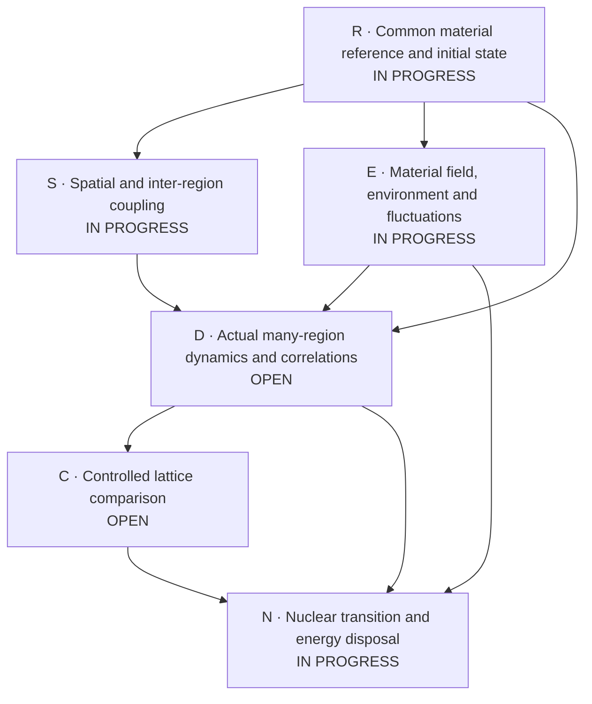
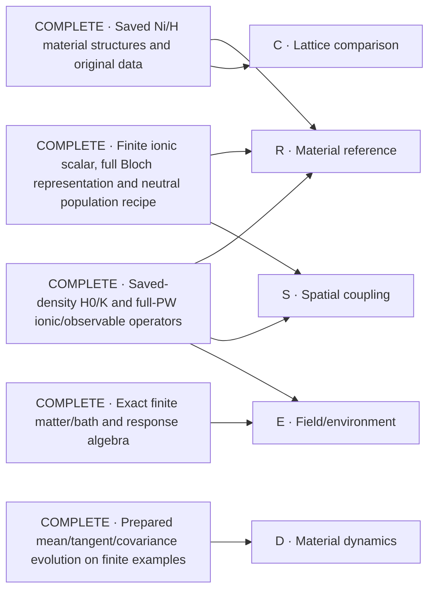

# Ni/H collective-response solution map

The objective is a material-calibrated many-region simulation, a defensible lattice comparison, and an explicit nuclear-transition/energy-disposal construction. This map keeps that whole objective visible. Nodes are scientific outputs, not approval checkpoints. The user's 28 October instruction is to reuse real existing solutions, solve the missing core nodes, and avoid process minutiae. The authoritative scope is [P254](proposal.yaml).

## Core scientific work

Solid arrows identify material inputs needed by a result. The nuclear mechanism can be investigated now; its material predictions eventually consume the calculated response. No open node is marked complete merely because a helper or a finite example works.

| Node | Required scientific output | Current work |
| --- | --- | --- |
| R | A declared full-material state with consistent density, force and curvature accounting; reference drift and approximation error remain visible. | Selected full-column non-Gamma state, density/gradient and H0 moments have run. Complete the weighted source/slot aggregation and convert the saved MV curvature to the declared conditional state. |
| S | Material-derived finite-wavevector and inter-region operators, with the actual ionic/electronic spatial coverage. | The actual complete frozen 4×4×4 q-grid and real-space force lattice have run. Rectangular electronic coupling is implemented; its actual material consumer is next. |
| E | A physical material/field/environment construction with its corresponding fluctuations and energy transfer. | Initial physical force-noise construction passes its independent oracle; material consumption is next. Actual optical contact refinement is not converged and is being repaired from the source operator, not fitted. |
| D | Actual material trajectories after local excitation, baseline motion, connected space/time correlations and energy accounting. | Moving-reference finite-q ket/bra evolution passes its independent oracle. Compose it with completed R/S/E material inputs; no full material trajectory is claimed. |
| C | Matched lattice comparisons whose conclusions survive relevant numerical, size and physical controls. | Reuse completed material structures; calculate missing comparative response, rather than rank hydrogen inventory. |
| N | A sourced transition operator and medium coupling with explicit energy/product disposal. | Investigate concrete mechanisms and available physical inputs; electronic or vibrational correlation alone does not supply a nuclear rate. |

The integrated result receives one complete scientific review and its necessary corrections, then the required distinct-authorized merge. These are delivery work, not extra scientific nodes.

## What is complete and reusable

These are completed constructions at their recorded scopes. The entries below identify existing solutions only; they do not imply an existing solution for every open node.

| Existing solution | Reuse | Evidence and scope |
| --- | --- | --- |
| Saved full-host material structures and original electronic files | Material geometry, species, masses and source wavefunctions; matched structural controls. | [Primary-material completion](https://github.com/vantasnerdan/substrate-framework/issues/225#issuecomment-6414684011). Declared coarse stationary inputs are complete; numerical calibration and coupled spectra are not thereby complete. |
| Matched saved-density Hamiltonian/kernel and full-PW force/number factors | Existing `qe_material_hamiltonian.py` and material factor/readback APIs, rather than another DFT reconstruction. | [A25 admission](attempts/0025/review-admission.json), with actual-material output and separate readback. This does not select a physical equilibrium state. |
| Full-coordinate material maps and prepared-state evolution | Existing `PreparedReference`, `PreparedFactorDynamics`, prepared covariance and observable consumers. | [A26 admission](attempts/0026/review-admission.json). Actual material maps are complete; finite-time prepared evolution was exercised on a synthetic system, not a completed material trajectory. |
| Finite ionic scalar/common force reference; lazy full Bloch grid; conditional neutral preparation | Existing ionic, `qe_bloch_*`, `material_preparation_*` and authenticated saved-output consumers. | [A27 admission](attempts/0027/review-admission.json). Full electronic representation and population ledger are complete; actual raw preparation/readout covers one selected Gamma sector. Finite ionic sums are not a convergence certificate. |
| Exact matter/field/bath elimination and finite-fermion response identities | Existing `material_matter_field.py` and the admitted finite-fermion constructions. | [A1](attempts/0001/receipt.json) and [A7](attempts/0007/receipt.json), also identified in [the source inventory](proposal.yaml). These supply algebra, not Ni-specific loss parameters or a nuclear mechanism. |
| Evaluated isotope and product-energy data | A source-backed Ni/H reaction ledger with explicit daughter products, decay topology and atomic-reference energy accounting. | [Actual ledger](attempts/0028/nuclear-product-energy-ledger.json), [AME2020/NUBASE2020 provenance](attempts/0028/nuclear-source-acquisition.json), and [source/physical scope](attempts/0028/nuclear-source-registration.json). This calculates available reaction energy, not fusion probability or deposited heat. |
| Actual frozen spatial force lattice | Complete saved-reference 4×4×4 q-grid and its real-space Fourier representation, with raw finite-grid residuals. | [Actual material output](attempts/0028/ionic-q-grid-material-001/result.json). This is frozen MV-reference curvature, not screened modes, an ASR-corrected matrix or the conditional-state curvature. |

## Current focus

The selected non-Gamma material source now has completed full-column state, density/gradient and H0 checkpoints; the successful H0 calculation reused both earlier boundaries. The complete frozen spatial grid has also run. The next work is full common-state/reference aggregation, actual rectangular material coupling and physical initial fluctuations, then the coupled trajectory. The optical current consumer ran, but its contact refinement is adverse; no converged contact or physical loss model is claimed. The evaluated nuclear/product-energy ledger remains available, not a nuclear transition rate. [Current allocation](attempts/0028/root-allocation-decision-004.json). No core node is closed by these component results.

Source and result details stay in the linked attempts. This document changes when a core result changes, not for every administrative action.
