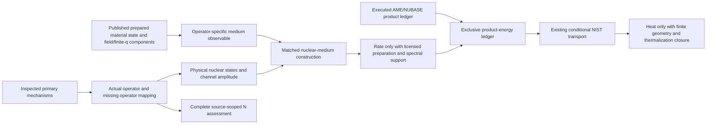

# N: source/operator-scoped nuclear bridge assessment

## Decision and earned scope

P254 G5/L5 permits an **exact sourced/operator assessment**, with nuclear-rate evidence only when complete licensed inputs exist. The scientific answer here is not “wait for a nuclear rate.” It is a mechanism-specific identification of the operator, preparation, matching, and product inputs that the inspected sources do and do not provide. That assessment is implemented below. **No material nuclear rate or heat is calculated; null means undetermined, not physical zero.** The full LENR parent objective is not completed by this assessment.

The actual consumer and its new independent SymPy oracle **passed** in [nuclear-medium-assessment-001.json](nuclear-medium-assessment-001.json). Original nuclear/material receipts were consumed and reused, not replayed. The result retains undetermined material rate/heat and the exact missing physical inputs; whole many-region dynamics and comparison remain separate work.



The lines from material response to a physical nuclear construction are **requirements**, not assertions that the missing connection exists. D/C can test collective material behavior and matched controls without supplying a nuclear matrix element. Completing D/C does not automatically complete those external physical inputs.

## Primary access, identity and exact citations

Original files were read, their raw-byte SHA256 computed before dependent claims, and identities checked. DPV and BDP PDFs are scans: all four/five original pages were visually inspected, not inferred from OCR. Kim's original four-page PDF text was inspected. The `.txt` companions are supplementary, not authority over the original pages.

| Primary original | Identity and inspected locations | Raw PDF SHA256 |
|---|---|---|
| `delgiudice-preparata-vitiello-1988-prl.pdf` | E. Del Giudice, G. Preparata, G. Vitiello, *Water as a Free Electric Dipole Laser*, Physical Review Letters **61**, 1085–1088 (29 August 1988), [DOI 10.1103/PhysRevLett.61.1085](https://doi.org/10.1103/PhysRevLett.61.1085). Eqs. (1)–(18), (29)–(34), conclusions p1088. | `477bca0dc97df286c672de41db45a2073ab3727d6747b00abccd68cc2cd41df4` |
| `bressani-delgiudice-preparata-1989-nuovo-cimento.pdf` | T. Bressani, E. Del Giudice, G. Preparata, *First Steps Toward an Understanding of «Cold» Nuclear Fusion*, Il Nuovo Cimento A **101**, 845–849 (May 1989), [DOI 10.1007/BF02844877](https://doi.org/10.1007/BF02844877). Eqs. (1)–(12), especially pp847–849. | `8d32899dea3fbd9b8de35ffdef63d1ec33d5ab6e5baa32e5ef2a81f9655e6267` |
| `kim-generalized-bec.pdf` | Y.E. Kim, *Generalized Theory of Bose-Einstein Condensation Nuclear Fusion for Hydrogen-Metal System*, PNMBTG-6-2011, June 18, 2011, [original PDF](https://lenr-canr.org/acrobat/KimYEgeneralize.pdf). Secs. II–IV, pp2–4, reaction labels (i)–(iv). | `55f3a034413413bdc1903da7a8221bb73ad110e0735ecb6312d8e5f8eef05761` |

Original local directory: `/home/administrator/sources/coherence`. All six PDF/text paths, sizes and digests are in `nuclear-medium-assessment-registration.json`; `--primary-source-dir` permits relocating these exact bytes. Root publication must retain/access these originals, not only this narrative. No identity is asserted between Kim's 2011 paper and its separately referenced mixture-theory publications. This assessment does not claim to reproduce unseen equations of those references.

## Mechanism-by-mechanism operator mapping

### 1. DPV1988: water electric-dipole coherence, not nuclear exchange

**Actual construction.** Eqs. (1)–(4) use a molecular rigid-rotor term `L_j²/(2I)` and electric-field–dipole coupling `A·d_j`; the paper explicitly calls `A` the electric field. Its impurity term is `-d_j·E_d`, Eq. (29). **This A is not the vector potential used in the present Ni/H field constructor.** Eqs. (7)–(18) introduce a dipole-orientation matter field and transverse radiation amplitudes, a long-wavelength approximation, and a rotational `l=0,1` truncation.

**Normalization/quantum numbers.** The source uses natural units `hbar=c=1`. Its water inertia and dipole parameters are molecular distances/masses, not Ni/H parameters. `integral dOmega |psi|²=N`; `psi=sqrt(N) xi` and `integral dOmega |xi|²=1`. Radiation amplitudes are correspondingly rescaled by `sqrt(N)`. The `|l,m>` labels are molecular rotational states; transverse polarization labels are not nuclear multipoles or nuclear `J^pi`.

**Permitted material entry.** Prepared Ni/H density, current and ionic observables can define/test a *different* Ni/H collective response after deriving its material operator and normalization. They cannot replace water dipoles, rotational populations or inertia by name. A current expectation or phase-coherent lattice displacement does not become a nuclear exchange operator.

**Products and exact gap.** This Hamiltonian supplies molecular polarization/radiation energy exchange, not nuclear entrance/daughter states, nuclear Q or reaction branching. To use it in a nuclear claim requires a specified Ni/H initial/final nuclear transition operator, a matching material observable and actual coupling. Absence of that operator in this water model is not a universal no-go.

### 2. BDP1989: screened dd entrance plus prescribed nuclear-to-electron drive

**Entrance.** Eqs. (1)–(3), p847, model charged-species plasma oscillations and an electron displacement scale. Eq. (4) gives the modified dd radial potential

`V'(r) = alpha/r [1 - (Z/2) r³/delta³]`.

Eq. (6), p848, estimates a WKB penetration factor `D`. This paper's Pd/Ti numerical penetrabilities are **not reproduced, verified or transplanted to Ni/H here**.

**Transition and medium.** Eq. (7) assumes coherent deuteron plasma motion/domain size. Eq. (8) represents a `4He* -> 4He` transition by a prescribed oscillating electric field containing the source's approximate transition energy, typical internal deuteron velocity and `sqrt(D)`. Eq. (9), p849, **does contain an electron-plasma transition amplitude**, with coherent electron-count enhancement. It would be inaccurate to say this paper writes no amplitude at all. The missing object is a normalized, state/multipole-resolved *intrinsic nuclear transition current*, and its material-specific justification. The electron amplitude is not an independently calibrated Ni receiver matrix element.

**Units and required labels.** Source equations set `hbar=c=1`; quoted plasma wavenumbers are `cm^-1`, lengths `cm`/`fm`, rates `s^-1`, and power density `W/cm³`. In the relevant plasma formulas `N/V` is the metal-atom density, `Z` the participating electron count per atom, and `f` the deuteron loading per atom; `mu` is the dd reduced mass and `D` dimensionless. The paper's roughly 24 MeV transition and typical internal velocity are hypotheses, not present material measurements. Actual nuclear `J^pi`, isospin, multipolarity, transition form factors, entrance normalization and allowed channels must be supplied; coherent plasma phase alone fixes none of them. No particular allowed nuclear multipole is inferred from the prescribed electric field.

**Permitted material entry.** The prepared density/force/current and a derived operator-specific response can test proposed screening or collective material oscillation. They do not establish nuclear-frequency response, spatial phase coherence over the source's proposed domain, or the source's electronic energy-transfer coefficient. Retarded response alone also does not supply an unsymmetrized fluctuation spectrum without the necessary state/statistical relation.

**Products and gap.** The source proposes dd fusion followed by electronic transfer, in competition with ordinary nuclear channels; its p849 discussion also mentions pd fusion. These need an actual D inventory and appropriate entrance states and are not the commissioned Ni+2p reaction. Required additional inputs are microscopic entrance matching down to nuclear distances; normalized nuclear states/current; frequency/momentum-resolved electronic/EM coupling and losses; spatial coherence/boundary conditions; branch spectra and finite absorber transport. Its Eqs. (10)–(12) quoted rates/power are not used as outputs.

### 3. Kim2011: correlated spin-singlet two-proton proposal

**Actual entrance proposal.** Sec. II assumes mobile even-A Ni nuclei and neighboring protons forming an `S=0` composite in a sufficiently weak local magnetic field, followed by a two-species condensation hypothesis. The proposed isotope set is A=58,60,62,64. Spin-singlet means antisymmetric spin and hence symmetric spatial exchange sector for the two identical protons; opposite spin directions alone establish neither a bound pair nor its lifetime/population.

**Actual exit labels.** The paper proposes:

- (i) `Ni(A)+2p -> Cu(A+1)+p`;
- (ii) `Ni(A)+2p -> Ni(A-2)+alpha`;
- (iii) `Ni(A)+2p -> Zn(A+1)+n`, with isotope-dependent energetic qualifications;
- it also discusses d, `3He` and t exits and a lithium-additive route (iv).

The present executed ledger covers the commissioned twelve (i)–(iii) Ni channels and separately labels ordinary binary capture. It does not pretend to compute the additive route or independently establish the paper's assertions about the other exits. Actual current AME/NUBASE records, not the paper's older quoted decay values, control energy/product accounting.

**Exact missing operator.** The supplied 2011 paper gives no normalized antisymmetrized Ni+p+p channel amplitude, no pair spatial wavefunction/population/lifetime, and no explicit operator coupling that amplitude to a calculated Ni/H observable. It refers to earlier BECNF work; those references are not silently replaced by a guessed kernel. Its concluding Sec. IV explicitly asks for established experimental entrances/outputs before selection-rule/rate estimates.

**What is needed.** A spin-resolved two-proton reduced density matrix with relative-coordinate resolution, pairing/condensation evidence and normalization; isotope-resolved Ni initial states; nuclear `J^pi`, isospin and entrance/exit angular momenta; normalized continuum/channel functions, transmission/partial widths and channel amplitude; and a justified material-to-nuclear spatial/energy matching. Where these definitions are absent, it is not possible to assign physical amplitude units or an absolute rate normalization by fiat.

**What material output can contribute.** Electronic preparation, ion positions/covariances, screening, forces and collective field response can constrain material conditions. They do not implement nuclear antisymmetrization or demonstrate pair off-diagonal long-range order. A conditional ionic trap vacuum is not a nuclear condensate. Coherent motion and low-energy material spectra cannot replace nuclear contact probability or a channel matrix element.

**Energy/product boundary.** Spectator-proton cancellation in atomic mass bookkeeping gives an energy identity, not equality of a correlated three-body amplitude and ordinary binary capture. Isotope changes, prompt/recoil/charged products, weak-decay leptons and possible gamma/neutron escape must remain separately accountable.

### 4. Already measured ordinary channels and a distinct sequential option

`measured-nuclear-channels-001.json` binds acquired Simon ordinary Ni(p,gamma) data and Lopez-Saavedra Cu59(p,alpha) data. They are inclusive, experimentally response-averaged cross sections, not complex nuclear amplitudes or resolved multipoles. Preserve source effective CM energies in MeV, cross sections in mb, finite-response qualifiers, uncertainties and upper limits. There is no extrapolation to thermal lattice energies.

The existing `ni_h_measured_channels`/`ni_h_sequential_channels` interfaces can use **externally supplied, response/state-matched proton fluxes** in `cm^-2 s^-1`, explicit target populations and time in seconds. Two encounters need two separate distributions plus an incoherent ground-state cascade reduction, intermediate stopping/decay and competing-channel closure. The existing material receipts provide no such MeV proton flux. A sequential `58Ni(p,gamma)59Cu(p,alpha)56Ni` construction does not equal Kim's coherent Ni+2p matrix element.

The acquired Simon printed Ni58 Q discrepancy remains in the receipt. AME2020 controls energy accounting; neither source values nor measured cross sections are silently repaired. No total sequential Q is assigned as one two-body emission or deposited heat.

## Consumed material receipts and normalization

The consumer checks registered raw bytes of the actual published JSONs, original nuclear data and material payload archives; it then consumes their values, scopes and array metadata. It does not rerun material constructors. Specific bindings are all in the registration, including:

- `full-common-reference-004/summary.json` and `full-common-reference.json`: completed full electronic coverage, explicit spin/mesh weights, complete atom order and prepared density/force/curvature metadata. The receipt's conditional-preparation, geometric covariance and finite-scalar limits are retained.
- `finiteq-material-001/result.json`: selected-column operator validation over physical PW rows, not a populated response trajectory. Directed q, unequal endpoint dimensions, grid measure, spin and weight are copied; its limitations travel with the assessment.
- `full-field-aggregate-001/result.json`: full spin/mesh zero-field moments with weights once, not nuclear-frequency spectral density. Its source-generation joint-scalar limits and absent field quantum state remain explicit; later field improvements do not retroactively change this receipt.
- `ionic-gaussian-material-002/result.json`: explicitly conditional sudden-release trap vacuum; covariance publication is not propagated trajectory or pair preparation.

Relevant existing constructors are `PreparedReference`, `PreparedFactorDynamics`, `PreparedBlochResponse` and `UniformMaxwellField`. Densities are `bohr^-3`, volume pairing is `bohr³`; H is Ry, u is bohr, positive ionic gradient Ry/bohr, and unmassweighted curvature Ry/bohr². Time is `tau=t Ry/hbar`; `Kq` maps density to Ry. Sector occupations/raw Gram structure and explicit mesh weights must be retained, without invented spin degeneracy.

The uniform periodic field uses `a=e A_SI/hbar` in `bohr^-1`, conjugate momentum Pi, and `E_Ha=-da/dtau/2`. It is q=0 and does not manufacture a cavity spectrum, finite-q matter bridge or normalizable oscillator vacuum. A nuclear-frequency medium observable requires its own matched operator, support and state; no eV-to-MeV extrapolation is licensed here.

## Strongest legitimate conditional bridge

For a **specified** interaction `H_int=sum_mu N_mu tensor B_mu` (Hermitian completion where needed), suppose nuclear matrix elements `n_mu=<f|N_mu|i>` are known, the initial medium is stationary and factorized, and weak-coupling/continuum/long-time golden-rule assumptions are justified. With dimensionless B and energy-valued n, define

`S_E,mu,nu(Delta) = sum_b,b' p_b conj(B_mu[b',b]) B_nu[b',b] delta(Delta-(epsilon_b'-epsilon_b))`.

Here `Delta=E_i-E_f` is the nuclear energy release, and positive Delta denotes energy **gained by the medium**. `S_E` has inverse-energy units. The conditional contraction is

`Gamma = (2 pi/hbar) n^dagger S_E(Delta) n`.

For the unsymmetrized convention `S_omega=int dt exp(i omega t)<B_mu^dagger(t)B_nu(0)>`, the consistent conversion is `S_omega(omega)=2 pi hbar S_E(hbar omega)` and `Gamma=n^dagger S_omega(Delta/hbar)n/hbar²`. This states a matching contract, not a material result or a claim that the cited papers supplied these operators. A nonstationary prepared trajectory needs a two-time treatment; neither stationarity nor FDT is assumed from the present receipts.

### Registered independent witness, not a physical ansatz

The new consumer includes an exact SymPy finite-dimensional witness: an initial nuclear state, a final nuclear projector, an asymmetric complex medium operator B, a normalized nonuniform medium density matrix, and `H=g|f><i| tensor B + h.c.` with no free Hamiltonian for the short-time calculation. A full Kronecker-space double commutator independently gives the coefficient of final population at order t². It is checked against the reduced `|g|² Tr(B rho B^dagger)/hbar²` expression. Changing g while keeping the medium fixed exposes the missing nuclear information. This is **not an irreversible rate, a nuclear model selected for Ni/H, or a material prediction**.

Independent diagonal-bath Heisenberg evolution checks the signed spectral-weight formula. SymPy's delta-function integration supplies the energy/frequency Jacobian. Mutations remove nuclear coupling, replace adjoint with transpose, reverse noncommuting order, reverse energy transfer, and drop the hbar Jacobian. Raw-byte corruption and required-receipt omission mutations also fail closed. These definitions and mutations were registered before implementation. The [executed receipt](nuclear-medium-assessment-001.json) records the passed witness, all five mathematical mutations and both admission mutations; none is a material nuclear prediction.

### Reuse of energy/transport primitives

The strongest justified product bridge is already available rather than a second implementation:

1. Licensed reaction/branch amplitudes and preparation would supply exclusive isotope/state populations and emitted energy/momentum spectra.
2. `ni_h_nuclear_ledger.reaction_energy` and `two_body_kinetic_energies` already support consistent atomic Q/reference corrections and explicitly specified two-body endpoints; current Q/topology results are reused, not recomputed.
3. The existing sequential network is available only for its separately licensed incoherent binary inputs, not as a substitute for the correlated entrance.
4. `nuclear_energy_transport.conditional_energy_ledger` accepts actual supplied photon lines/quadrature counts, charged kinetic energies and explicit finite paths/tracks. It preserves uncollided photons, primary kerma/collision slowing, unresolved secondary radiation/recoil and any explicitly free-streaming neutrino energy as distinct quantities.

Existing NIST tables do **not** provide Ni proton/alpha stopping, Ni/H compound absorption, heavy-recoil/positron/neutron transport, exclusive nuclear spectra or a finite specimen geometry. Photonuclear omissions matter at nuclear energies. A periodic 4³ material cell is not a finite absorber. Elemental `mu_en` is not automatically mass-additive for a compound. Per-event removal, kerma or norm loss is not heat; power additionally requires actual reaction rates and thermalization/escape closure. No artificial spectrum is inserted just to exercise this connection.

## Existing exercised evidence versus new execution

Reused published scientific evidence:

- `nuclear-product-energy-ledger.json`, SHA256 `37969bea7d713859393ffd935765e60e37852cf94fe7ecfa1a0c7ea31b4a9497`: evaluated reaction/product/decay ledger, explicitly null fusion and heat rate.
- `measured-nuclear-channels-001.json`, SHA256 `0f75c1a0dac7fa485e399c858d17b977c1c09e88e7cd183fdffb78233bbc8c96`: actual ordinary measured tables and exact energy identities; correlated amplitude, receiver, material entrance/rate/heat remain null.
- `nuclear-energy-transport-001.json`, SHA256 `5a5cf9b1be9f588f691ae04420e0cacd8a6c1d6130c134ad9b0e8b936a570a15`: actual primary-table inventory and explicit data/transport gaps; no heat or power.
- Existing oracle evidence: `nuclear-oracle-command-002.json` (recorded exit 0), `measured-nuclear-oracle-001.json` (recorded `pass`), `nuclear-transport-oracle-002.json` (recorded `passed`). These statements describe inspected receipts, not fresh reruns.

The new consumer retains all original-data and receipt bindings; it emits channel/product Q rows, isotope quantum-number/decay records, measured domains and table values, material normalization/scope, the operator assessments, exact missing physical prerequisites, and the newly executed formal oracle. Its material rate and heat fields remain null even when all mathematical checks pass.

## Root run and full input requirements

From the repository root, using the existing Python environment with SymPy:

```sh
taskset -c 6-10 env OMP_NUM_THREADS=1 OPENBLAS_NUM_THREADS=1 MKL_NUM_THREADS=1 \
  python proposals/P254-ni-collective-response/attempts/0028/run_nuclear_medium_assessment.py \
  --output proposals/P254-ni-collective-response/attempts/0028/nuclear-medium-assessment-001.json
```

Use a new output path; evidence is not overwritten. `--primary-source-dir /path/to/originals` relocates only the six exact primary PDF/text originals. Every other registered path is repository-relative or an explicitly bound published archive. Requirements are:

- this registration and consumer;
- the six named original primary files;
- the exact AME/NUBASE, measured-paper and NIST/empty-table original bytes listed in `original_nuclear_sources`;
- all eleven registered published JSON receipts and their three bound material NPZ archives;
- the eight registered existing implementation-source snapshots; no new nuclear production module is needed;
- Python standard library plus SymPy. No Native job, cloud, frozen-unit execution or new material numerical solve.

Any changed bytes, missing receipt, unsuccessful upstream oracle or failed new oracle aborts without a success receipt. Source-generation changes require explicit review rather than silently updating a digest to make admission pass.

**Closure boundary:** a successful Root run earns complete G5/L5 source/operator/input/product assessment, including exact missing prerequisites. It does not wait indefinitely for an unavailable rate, and it does not diminish the full parent objective. After D/C, remaining external physical requirements are actual nuclear/pair preparation, channel/receiver amplitudes and state matching, nuclear-frequency coupling/spectral support, exclusive product spectra, and finite-specimen transport/thermalization. None is replaced by a universal no-go, a physical zero rate or an invented heat calculation.
